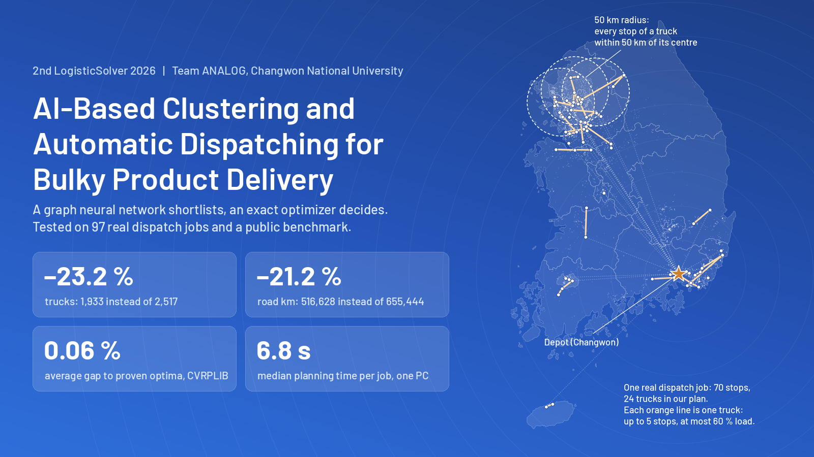
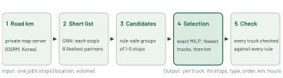
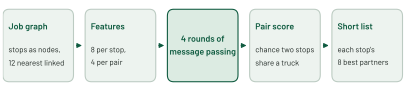
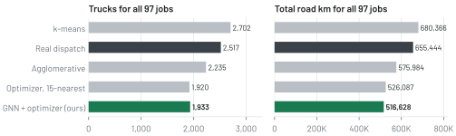
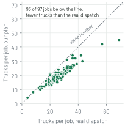
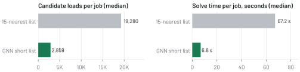
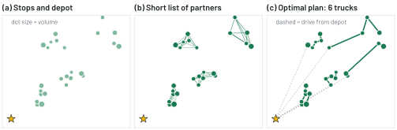

<p align="center">
  
</p>

# AI-Based Clustering and Automatic Dispatching for Bulky Product Delivery

**Team ANALOG** (AI-based New Approach for LOGistics), Changwon National University.
Entry to the **2nd LogisticSolver 2026: Smart Logistics Problem-Solving Competition**.

A home-appliance manufacturer in the Changwon area ships bulky products (air coolers, large fans and similar equipment) from one depot to customers all over South Korea, with trucks hired per trip. Today a dispatcher groups the addresses into trucks by hand. This repository holds a planner that **groups and routes together**: a graph neural network (GNN) shortlists each stop's likely truck partners, and an exact optimizer picks the plan with the fewest trucks, then the fewest road kilometres, under every company rule.

| | English | 한국어 |
|---|---|---|
| Report | [PDF](competition/build/ANALOG_LogisticSolver2026_Report.pdf) | [PDF](competition/build/ANALOG_LogisticSolver2026_Report_KO.pdf) |
| Slides | [PowerPoint](competition/build/ANALOG_LogisticSolver2026_Slides.pptx) | [PowerPoint](competition/build/ANALOG_LogisticSolver2026_Slides_KO.pptx) |

## Contents

[Results at a glance](#results-at-a-glance) | [The problem](#the-problem) | [How it works](#how-it-works) | [Results](#results) | [Try it without the company data](#try-it-without-the-company-data) | [Full pipeline](#full-pipeline-needs-the-company-data) | [Repository layout](#repository-layout) | [Data and privacy](#data-and-privacy) | [Limitations](#limitations) | [Team and references](#team-and-references)

## Results at a glance

All 97 real dispatch jobs (6,395 stops, 7 April to 7 August 2026), the same roads and the same rules for every plan:

| KPI | Real dispatch | GNN + optimizer (ours) | Change |
|---|--:|--:|--:|
| Trucks | 2,517 | **1,933** | **−23.2 %** |
| Total road km | 655,444 | **516,628** | **−21.2 %** |
| Driving hours | 8,880 | **7,163** | **−19.3 %** |
| Rule violations in the plan | | **0** | |
| Planning time per job | by hand | **6.8 s** (median, one PC) | |

- Fewer trucks than the real dispatch on **93 of 97 jobs**, the same on 3, one more on 1.
- **Accuracy you can check:** on the public CVRPLIB benchmark the optimizer (15-nearest list) finds the proven optimum on 4 of 5 instances and is 0.3 % above it on the fifth, **0.06 % on average**.

## The problem

| Rule | Value |
|---|---|
| Addresses per truck | 1 to 5 |
| Load limit | at most 60 % of the truck's inner box volume (safe packing, no stacking) |
| Area | every stop within 50 km of the load's centre |
| Trucks that may carry several addresses | 1-ton (4.22 m³ usable) or 1.4-ton (4.73 m³), at most ten 1.4-ton trucks per job |
| Larger trucks (2.5-ton and up) | one address only (132 stops are too big for a 1.4-ton) |
| Objective | first the fewest trucks, then the fewest road km; routes run one way from the depot |

<p align="center"></p>

**Why it is hard.** A job with 63 stops has about 7.7 million groups of up to 5 stops. Choosing groups that cover every stop exactly once is the set-partitioning problem, which is NP-hard, and the cap of ten 1.4-ton trucks ties all groups of a job together. Greedy rules and k-means handle one rule at a time and waste trucks.

## How it works

<p align="center"></p>

1. **Road km.** A private [OSRM](https://project-osrm.org/) server on OpenStreetMap data gives the road distance and driving time between the depot and every stop. No address is sent to an online service.
2. **GNN short list.** Each job is a graph: stops are nodes, each linked to its 12 nearest stops (8 features per stop, 4 per link). Four rounds of edge-state message passing (137,857 parameters) score how likely two stops are to share a truck, and every stop keeps its **8 best partners**. The GNN is trained on the optimizer's own plans and is tested out of fold on date blocks it never saw: **AUC 0.74**.
3. **Candidate loads.** Every group of 1 to 5 stops from a stop and its partners that obeys every rule: 2,859 per job (median) instead of 19,280 with the 15 nearest stops. A greedy plan is always added as a safety net.
4. **Exact selection.** Two mixed-integer programs solved with HiGHS: stage A finds the fewest trucks (with at most ten 1.4-ton trucks), stage B the fewest km at that truck count. A load's km is its best stop order (all at most 120 orders are tried), so **grouping and routing are decided together**. At most 60 s per stage.
5. **Rule check.** Every truck of the plan is checked against every rule; a failure stops the run.

<p align="center"></p>

The GNN ranks, it never decides: the optimizer and the rule check keep every guarantee, whatever the model scores. This is the design summed up as **AI for speed, optimizer for quality**.

## Results

<p align="center"></p>

| Method | Trucks | vs real | Total road km | vs real | Driving h |
|---|--:|--:|--:|--:|--:|
| Real dispatch | 2,517 | | 655,444 | | 8,880 |
| k-means, split where a rule breaks | 2,702 | +7.4 % | 680,366 | +3.8 % | 9,170 |
| Agglomerative clustering on road km | 2,235 | −11.2 % | 575,984 | −12.1 % | 7,844 |
| Google OR-Tools, 30 s per job | 2,264 | −10.1 % | 577,639 | −11.9 % | 7,936 |
| Optimizer, 15-nearest list | 1,920 | −23.7 % | 526,087 | −19.7 % | 7,303 |
| Optimizer, 8-nearest list | 1,941 | −22.9 % | 518,682 | −20.9 % | 7,185 |
| **GNN + optimizer (ours)** | **1,933** | **−23.2 %** | **516,628** | **−21.2 %** | **7,163** |

- **The optimizer saves the trucks.** Every optimizer row beats every other method by at least 294 trucks.
- **What the GNN adds.** At the same list size it finds 8 fewer trucks and 2,054 fewer km than the 8 nearest stops (better on 9 jobs, worse on 2). Against the 15-nearest list it needs 13 more trucks (0.7 %) but solves **ten times faster**. The gain over plain nearest neighbours is small but real.
- **A standard solver is not enough.** OR-Tools cannot express the 50 km radius rule: its routes broke it on 89 of 97 jobs and had to be split.
- **Not an artefact of rule breaks.** 230 real groups are outside the written rules, but on the 13 jobs where every real group obeys them the plan still needs 28.2 % fewer trucks.

<p align="center"></p>

<p align="center"></p>

| Optimizer with | Median time per job | Slowest job | Jobs at the 60 s limit | Trucks |
|---|--:|--:|--:|--:|
| 15-nearest list | 67.2 s | 141 s | 13 | 1,920 |
| 8-nearest list | 5.8 s | 72 s | 0 | 1,941 |
| **GNN short list (ours)** | **6.8 s** | 120 s | 2 | 1,933 |

**Public benchmark** ([CVRPLIB](http://galgos.inf.puc-rio.br/cvrplib/) set P, Augerat et al. 1995): every instance whose proven optimal routes visit at most 5 customers, the same limit as the company's 5-address rule.

| Instance | Customers | Proven optimum | Our distance | Gap | Time |
|---|--:|--:|--:|--:|--:|
| P-n16-k8 | 15 | 450 | 450 | 0.0 % | 0.1 s |
| P-n22-k8 | 21 | 603 | 603 | 0.0 % | 0.9 s |
| P-n23-k8 | 22 | 529 | 529 | 0.0 % | 0.3 s |
| P-n55-k15 | 54 | 989 | 992 | 0.3 % | 7.2 s |
| P-n60-k15 | 59 | 968 | 968 | 0.0 % | 16.8 s |

The benchmark tests the optimizer and its distance code, with the 15-nearest list. It is not a hard test: with routes of at most 5 customers the list holds almost every useful route. With an 8-nearest list the optimizer is 10.4 % above the optimum on P-n23-k8 and needs one more vehicle on P-n55-k15 (`competition/benchmark/results_k8.json`).

## Try it without the company data

The tests, the worked example and the benchmark need no company data:

```bash
git clone https://github.com/lexus-x/logistics.git && cd logistics
python3 -m venv .venv && .venv/bin/pip install -r requirements.txt

.venv/bin/python -I cluster/test_exact.py       # candidate loads and the exact solver on toy jobs
.venv/bin/python -I cluster/test_ryry.py        # routing, truck choice, the 1.4-ton cap, GNN plumbing, rule check
.venv/bin/python -I competition/demo.py         # the report's worked example (Figure 5, Table 13)
.venv/bin/python -I competition/benchmark.py    # CVRPLIB set P, about 30 s; writes competition/benchmark/results.json
```

`demo.py` plans the report's synthetic 26-stop job with the real planner code and checks every rule:

```text
26 stops, 1,496 candidate loads, solved in 0.3 s

| Truck | Stops in visiting order | Volume (m³) | Truck size | Share of the 60 % limit | km |
|--:|---|--:|---|--:|--:|
| 1 | S03 → S05 → S01 → S08 → S04 | 4.55 | 1.4-ton | 96 % | 87 |
| 2 | S02 → S07 → S06 | 4.53 | 1.4-ton | 96 % | 79 |
| 3 | S10 → S14 → S11 → S09 → S12 | 3.96 | 1-ton | 94 % | 156 |
| 4 | S16 → S17 → S20 → S21 → S19 | 4.40 | 1.4-ton | 93 % | 184 |
| 5 | S13 → S15 → S26 → S23 | 4.66 | 1.4-ton | 98 % | 239 |
| 6 | S18 → S22 → S25 → S24 | 3.49 | 1-ton | 83 % | 283 |

6 trucks, 1,028 km. Every rule met; 25.6 m³ needs at least 6 trucks of 4.73 m³, so no plan uses fewer.
```

<p align="center"></p>

The published sample rounds coordinates to 0.1 km, so the totals can differ from the report's Table 13 by rounding (1,028 km here, 1,029 km in the report).

## Full pipeline (needs the company data)

The 97 real jobs are company records with personal data, so they are not in this repository. With the stop table at `data/97_SPATIAL_EXPERIMENT_FROZEN.csv` and Docker:

```bash
bash cluster/osrm.sh build && bash cluster/osrm.sh serve   # local road server for South Korea on 127.0.0.1:5055
.venv/bin/python -I cluster/ryry.py osrm    # road km and driving hours for every job
.venv/bin/python -I cluster/ryry.py base    # real dispatch, k-means and the optimizer with the 15-nearest list
.venv/bin/python -I cluster/ryry.py agg     # agglomerative clustering
.venv/bin/python -I cluster/ryry.py knn8    # the optimizer with the 8-nearest list
.venv/bin/python -I cluster/ryry.py gnn     # GNN, 5 folds out of fold, and GNN + optimizer (a GPU makes training faster)
.venv/bin/python -I cluster/ryry.py plan data/97_SPATIAL_EXPERIMENT_FROZEN.csv gnn_opt   # plan sheet, IDs and numbers only
pip install ortools==9.15.6755 && .venv/bin/python -I competition/ortools_baseline.py   # the OR-Tools baseline
```

The saved per-job results of these runs are in `cluster/results/` (job IDs, stop indices and numbers only).

**Rebuild the report and slides** (pandoc 3, Node 18 or later, poppler-utils):

```bash
(cd .bin/pw && npm ci && npx playwright install chromium)   # headless Chromium for the PDF
.venv/bin/python -I competition/build.py      # English report -> ~/reports/LogisticSolver_2026/ (PDF, DOCX) and competition/build/
.venv/bin/python -I competition/build.py ko   # Korean edition
(cd competition && npm install)               # pptxgenjs
node competition/make_deck.js                 # English slides -> ~/reports/LogisticSolver_2026/
node competition/make_deck.js ko              # Korean slides
```

## Repository layout

| Path | What it holds |
|---|---|
| `cluster/ryry.py` | The planner: data loading, road matrices, truck choice, baselines (k-means, agglomerative, greedy), the GNN, exact selection, scoring and the plan sheet |
| `cluster/exact.py` | Candidate loads from nearest-neighbour lists, the radius and volume filters, the rule check |
| `cluster/osrm.sh` | Local OSRM road server for South Korea (Docker, OpenStreetMap) |
| `cluster/test_exact.py`, `cluster/test_ryry.py` | Tests on toy jobs |
| `cluster/results/` | Saved per-job results of every method on the 97 real jobs |
| `competition/report.md`, `report_ko.md` | Report source, English and Korean; `build.py` + `template.html` make the PDF and DOCX |
| `competition/make_deck.js`, `apply_theme.js` | Editable slide decks, English and Korean |
| `competition/build/` | The report PDFs and slide decks as submitted |
| `competition/demo.py`, `synthetic_job.json` | The worked example on synthetic data |
| `competition/benchmark.py`, `benchmark/` | The CVRPLIB set-P accuracy test, its instances and results |
| `competition/ortools_baseline.py` | The Google OR-Tools baseline |
| `competition/numbers.json` | Every number quoted in the report and slides |
| `competition/webfigs/` | Slide figures in the prototype's look (`fig.html`, rendered by `render.mjs`), and the framed prototype screens (`frame.py`) |
| `competition/figs/` | Figures (English; Korean in `ko/`) |
| `competition/fonts/` | Open fonts used by the report (SIL OFL 1.1) |

## Data and privacy

- The planner never uses customer names or phone numbers, and road distances come from a private map server, so no address is sent to an online service.
- This repository holds no customer fields and no stop coordinates. Saved results hold job IDs, stop indices and numbers only. The maps show stops as unlabeled dots at national scale, and every worked example uses synthetic data.
- The interactive prototype shows customer locations, so it is not published; it is demonstrated live at the presentation.

## Limitations

- The plan follows the written rules; time windows, driver hours and unloading constraints are not in the data yet. The cap of ten 1.4-ton trucks is assumed per job.
- *Exact* means exact over the candidate loads, not a proof that a plan is the best possible for the whole job.
- The benchmark tests the optimizer, not the GNN, and only on round trips without the radius rule. The GNN's gain over the 8 nearest stops is small (8 trucks over 97 jobs).
- The data cover one company over four months of its main season, so yearly figures are an upper bound.

## Team and references

**Team ANALOG**, Changwon National University: Ryry Rizky Asri (team lead, Department of Information and Communication Engineering), 최영은 and 최정혜 (Department of Electronic Engineering).

- R. R. Asri, A. B. Wahyutama, M. Hwang and K. Jin, "Automated Clustering and Vehicle Dispatching Service for Bulky Product Delivery," *2026 IEEE Int. Conf. on Industry 4.0, Artificial Intelligence, and Communications Technology (IAICT)*, 2026. [doi:10.1109/IAICT71158.2026.11621014](https://doi.org/10.1109/IAICT71158.2026.11621014). The team's earlier, rule-based method for the same company.
- P. Augerat et al., "Computational results with a branch and cut code for the capacitated vehicle routing problem," Research Report 949-M, Université Joseph Fourier, Grenoble, 1995 (CVRPLIB set P).
- Q. Huangfu and J. A. J. Hall, "Parallelizing the dual revised simplex method," *Mathematical Programming Computation* 10, 2018 (HiGHS).
- D. Luxen and C. Vetter, "Real-time routing with OpenStreetMap data," *ACM SIGSPATIAL GIS*, 2011 (OSRM). Map data © OpenStreetMap contributors, ODbL.

The full reference list is in the report. Included fonts (Barlow, IBM Plex, Noto Sans KR) are under the SIL Open Font License 1.1; see `competition/fonts/OFL-*.txt`.
