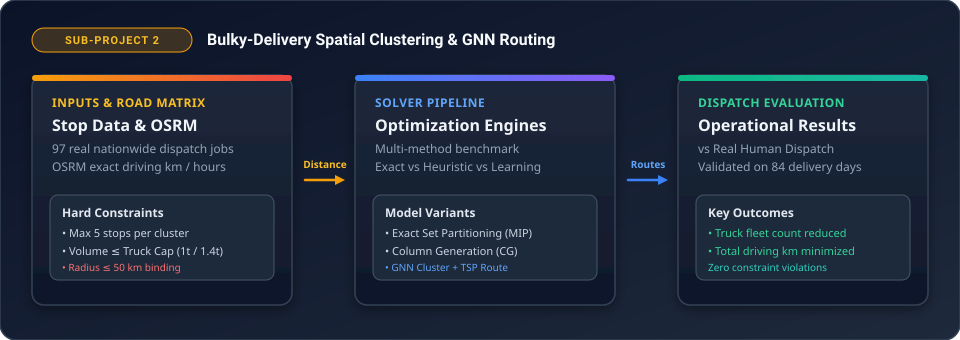

  # Bulky-Delivery Spatial Clustering &amp; GNN Routing

Automated vehicle clustering and dispatch system for nationwide bulky-delivery operations across South Korea (97 delivery jobs, 6,404 stops).

Combines exact mathematical programming (MIP Set Partitioning, Column Generation) with Multi-Task Graph Neural Networks (GNN, Transformer, Pointer Networks) and physical floor-loading feasibility checks (MaxRects &amp; CP-SAT) to minimize truck fleet count and total driving kilometers under strict operational constraints.

> [!NOTE]
> 📊 **Interactive Figures Dashboard**: Open [`docs/figures/index.html`](docs/figures/index.html) for the visual architecture guide and operational metrics breakdown.

---

### System Architecture Pipeline


---

## Operational Constraints

1. **Cluster Capacity**: $\le 5$ stops per cluster/truck.
2. **Volume Limit**: Total stop box volume $\le 60\%$ of rated truck box volume (hard constraint, covers no stacking).
3. **Spatial Radius**: Delivery cluster radius $\le 50\text{ km}$ from the cluster center.
4. **Fleet Rules**: Multi-stop routes use small trucks (1-ton or at most 10 $\times$ 1.4-ton per job). Trucks $\ge 2.5\text{t}$ serve single-address direct deliveries only.
5. **Physical Loading**: 2D floor loading feasibility check (MaxRects heuristic + exact CP-SAT solver for ambiguous loads).

---

## Setup &amp; Execution

```bash
# 1. Local OSRM Korean Road Network (Docker, 127.0.0.1:5055)
bash cluster/osrm.sh build && bash cluster/osrm.sh serve

# 2. Baseline Solvers & GNN Dispatch (Greedy, K-Means, MIP, GNN)
.venv/bin/python -I cluster/ryry.py osrm|base|gnn|agg|knn8|depot|forward|summary|plan

# 3. Column Generation Provable Lower Bound
.venv/bin/python cluster/ryry_cg.py

# 4. Version 3: Multi-Task Models (GNN / Transformer / Pointer) & Physical Fit
.venv/bin/python -I cluster/ryry_v3.py ref|train|alone|e2e|extra

# 5. Physical Floor-Packing & Rule Sensitivity Audits
.venv/bin/python cluster/ryry_load.py     # floor loading feasibility audit
.venv/bin/python cluster/ryry_rules.py    # marginal price of each operational rule
.venv/bin/python cluster/ryry_cost.py     # freight cost estimation from public rates

# 6. Test Suite
.venv/bin/python cluster/test_exact.py; .venv/bin/python -I cluster/test_ryry.py; .venv/bin/python -I cluster/test_v3.py; .venv/bin/python -I cluster/pack.py
```

---

## Repository Layout

| Path | Description |
|---|---|
| `cluster/ryry.py` | Core dispatch solver: real dispatch parser, rule-based heuristics, k-means, exact MIP, GNN, and OSRM routing |
| `cluster/ryry_v3.py` | Version 3 multi-task architecture: GNN, Transformer, and Pointer encoders for stop pairing, load fit, road km, and truck counts |
| `cluster/ryry_cg.py` | Column Generation solver &amp; Farley lower bound calculator |
| `cluster/pack.py` | 2D MaxRects floor-packing feasibility check |
| `cluster/pack_exact.py` | Exact CP-SAT floor packing for undecided configurations (`ortools`) |
| `cluster/ryry_load.py` | Physical loading audit across all 97 jobs |
| `cluster/ryry_rules.py` | Price-of-rules sensitivity experiment (varying radius, stop count, fill rate, truck limits) |
| `cluster/ryry_cost.py` | Transportation cost calculation based on Korean freight list prices |
| `cluster/ryry_items.py` | Item dimension parsing and box grouping per delivery stop |
| `cluster/exact.py` | Exact set-partitioning integer programming solvers (HiGHS) |
| `cluster/osrm.sh` | Docker orchestration for local OpenStreetMap South Korea OSRM backend |
| `cluster/site/` | Cloudflare Worker password-gated results portal |
| `cluster/results/` | Benchmark outputs: plan CSVs, JSONL logs, lower bounds, and summary tables |
| `riri-form/` | Question and data collection Cloudflare Worker for field feedback |
| `output/reports/` | Literature analyses (`literature_ai_models.md`, `literature_ryry.md`), freight rates (`freight_rates_kr.md`), and clustering plan |
| `docs/figures/` | Architecture vector schematics and standalone interactive HTML figure dashboard |
