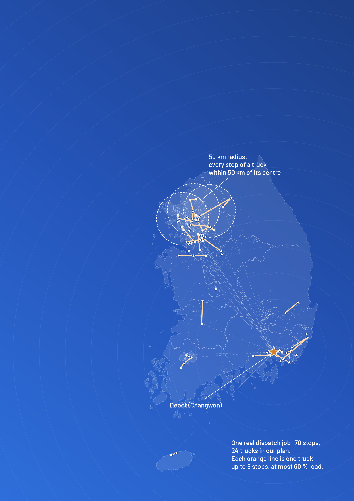

::: cover
::: cover-top
2nd LogisticSolver 2026: Smart Logistics Problem-Solving Competition
:::

::: cover-title
AI-Based Automatic Dispatch Clustering for Large-Volume Bulky Delivery
:::

::: cover-sub
A graph neural network that shortlists and an exact optimizer that decides, tested on 97 real dispatch jobs and on a public benchmark
:::

::: cover-stats
[**−23.2 %**]{.stat} [trucks: 1,933 instead of 2,517]{.stat-l}

[**−21.2 %**]{.stat} [road km: 516,628 instead of 655,444]{.stat-l}

[**0.06 %**]{.stat} [average gap to the proven optimum on a public benchmark]{.stat-l}
:::

::: cover-art

:::

::: cover-team
**Team ANALOG** (AI-based New Approach for LOGistics)

Ryry Rizky Asri (team lead), Department of Information and Communication Engineering\
최영은, Department of Electronic Engineering\
최정혜, Department of Electronic Engineering

Changwon National University, November 2026
:::
:::

```{=openxml}
<w:p><w:r><w:br w:type="page"/></w:r></w:p>
```

::: contents
**Contents**

1. Introduction: the problem in the field
2. Problem definition
3. Data: sources, processing and privacy
4. Method, and why each step is needed
5. Implementation and code
6. Experimental setup, and why it is fair
7. Results: savings, accuracy and speed
8. Expected effects on logistics KPIs
9. Prototype
10. Deployment plan, resources and risks
11. Novelty and differentiation
12. Limitations and conclusion
:::

## Summary

A home-appliance manufacturer in the Changwon area ships large products (air coolers, large fans and similar equipment) from one depot to customers all over South Korea with hired trucks. For every dispatch job, a planner groups the delivery addresses into trucks by hand, following company rules: at most 5 addresses per truck, a load limit of 60 % of the truck's box volume, all addresses within 50 km of the group's centre, and at most ten 1.4-ton trucks per job. Done by hand, this grouping uses more trucks and more kilometres than necessary.

We built a planner that groups and routes together. A **graph neural network (GNN)** reads the stops of a job and keeps, for each stop, only its 8 most likely truck partners; on jobs it never saw, it ranks a true partner above a false one 74 % of the time (AUC 0.74). Every group from that short list that obeys the company rules becomes a candidate load. An **exact optimizer** (a mixed-integer program) then picks, among these candidates, the combination that uses the fewest trucks and, among those, the fewest road kilometres on real Korean roads. Every truck of the final plan is checked automatically against every rule.

On 97 real dispatch jobs (6,395 stops, April to August 2026) the plan needs [**1,933 trucks instead of 2,517 (−23.2 %)**]{.hl} and drives [**516,628 km instead of 655,444 (−21.2 %)**]{.hl}, with every company rule met. A standard routing solver, Google OR-Tools, needs 2,264 trucks on the same jobs, because it cannot express the company's radius rule. Planning takes [**6.8 s per job**]{.hl} (median) on one PC, ten times faster than the same optimizer with a list of the 15 nearest stops, and with fewer trucks than a list of the 8 nearest. To show that the optimizer is accurate, we also ran it on a **public benchmark** used in vehicle-routing research for three decades (CVRPLIB, set P [14]): on the five instances that fit the 5-address rule, with the 15-nearest list, it finds the proven optimum on four and is 0.3 % above it on the fifth, [**0.06 % on average**]{.hl}.

: Results at a glance.

| KPI | Real dispatch | This work (GNN + optimizer) | Change |
|---|--:|--:|--:|
| Trucks (97 real jobs) | 2,517 | **1,933** | **−23.2 %** |
| Total road km (97 real jobs) | 655,444 | **516,628** | **−21.2 %** |
| Driving hours (97 real jobs) | 8,880 | **7,163** | **−19.3 %** |
| Planning time per job | by hand | **6.8 s** (median) | |
| Gap to the proven optimum (public benchmark, 5 instances) | | **0.06 %** on average | |

: Table 1. Key terms used in this report.

| Term | Meaning |
|---|---|
| Dispatch job, stop, load | A batch of deliveries planned together; one delivery address; the stops served by one truck |
| Short list | For each stop, the few partners it may share a truck with; only groups from these partners are considered |
| Graph neural network (GNN) | A neural network that reads the stops and their links to neighbours and scores how likely two stops are to share a truck |
| MILP | Mixed-integer linear program: an optimization model with yes-or-no decisions, solved exactly by a solver |
| Benchmark (CVRPLIB) | A public library of routing test problems whose best possible answers are proven; used to compare methods |
| Optimality gap | How far a plan is above the proven best plan, in percent; 0 % means the plan is optimal |
| AUC | The chance that a true pair is ranked above a false one (0.5 is random, 1.0 is perfect) |

# 1. Introduction: the problem in the field

**Bulky delivery is planned truck by truck.** Our partner company delivers large home appliances from its depot in Changwon to customers across the whole country. The trucks and drivers are hired per trip from third-party carriers, so the company never runs short of trucks; the question is how few it needs. A typical dispatch job has 63 delivery addresses (from 8 to 141), and each address receives about 0.9 m³ of boxes, a fifth of a small truck. Five typical addresses already fill a 1-ton truck, so the volume rule decides almost every grouping.

**Today the grouping is done by people, following rules of thumb.** A dispatcher looks at the addresses, groups neighbours into trucks, checks the load and the distances, and assigns a truck size. This takes time every day, depends on the person, and nobody can tell how far a plan is from the best one.

**What we set out to do.** Build a planner that (1) always meets the company rules, (2) needs as few trucks and kilometres as possible, (3) is fast enough for daily use, and (4) is measurably accurate, on a public benchmark that anyone can check. Table 2 lists the KPIs we measure and what we reached.

: Table 2. Logistics KPIs, how we measure them, and the result.

| KPI | How it is measured | Goal | Result |
|---|---|---|---|
| Trucks | Trucks hired for all 97 jobs | Fewer than the real dispatch | 1,933 (−23.2 %) |
| Total road km and driving hours | Real road network, best stop order | Fewer | 516,628 km (−21.2 %); −19.3 % hours |
| Rule compliance | Automatic check of every truck | 100 % | 100 % (0 violations) |
| Accuracy | Gap to the proven optimum on public benchmark instances | Within 1 % | 0.06 % on average; optimal on 4 of 5 |
| Planning time (lead time of planning) | Seconds per job on one PC | Under 1 minute | 6.8 s median |

**Why these KPIs.** Trucks are the largest cost: each truck is a separate hired trip. Kilometres and driving hours set fuel use and driver time. Rule compliance decides whether a plan can be used at all, and planning time decides whether it fits the daily routine. Accuracy against a proven optimum is how routing methods are compared in research [10, 15], so it is the measure a reviewer can trust.

**Existing approaches.** Grouping deliveries into trucks and ordering the stops is the capacitated vehicle routing problem [10]. Classic heuristics build routes by merging nearby stops, as in the savings algorithm [11], or cluster first and route second [12]. They are fast but say nothing about how far their plan is from the best one. Exact methods choose among candidate routes with set partitioning [2] and integer programming, often with column generation [4]. They are accurate, but they become slow when every possible route has to be considered. Neural networks that output routes directly are fast [13], but they cannot guarantee hard business rules such as a load limit. Learning which candidates an exact solver needs [7] combines speed with guarantees. Our team's earlier work [1] automated this company's grouping with a rule-based method; this report presents a new planner, compared with the real dispatch.

**How this report maps to the judging criteria.** Problem definition and KPIs: sections 1 and 2. Data plan: section 3. Creativity and differentiation: sections 4 and 11. Feasibility (technology, data, schedule, risks): sections 5 and 10. Quantified expected effects: section 8.

# 2. Problem definition

A **dispatch job** is a batch of deliveries planned together. A **stop** is one delivery address. A **load** (or cluster) is the set of stops that one truck serves. Each truck drives from the depot to its first stop and on to the others; it does not return, because carriers are hired one way. The rules come from the company's constraint list and are summarized in Table 3.

: Table 3. The company's dispatch rules.

| Rule | Value |
|---|---|
| Addresses per truck | 1 to 5 |
| Load limit | At most 60 % of the truck's inner box volume (safe packing, no stacking) |
| Area | Every stop within 50 km of the load's centre |
| Trucks that may carry several addresses | 1-ton (4.22 m³ usable) or 1.4-ton (4.73 m³ usable) |
| 1.4-ton trucks | At most 10 per job |
| Larger trucks (2.5-ton and up) | One address only; used for the 132 stops too big for a 1.4-ton |
| Fleet | Unlimited (hired per trip) |
| Every stop | Served exactly once |


**Objective.** First, the fewest trucks. Second, among plans with the fewest trucks, the fewest road kilometres. [*Why this order:*]{.why} every truck is a separate hired trip and costs far more than a few extra kilometres; once the number of trucks is fixed, kilometres decide fuel and driving time.

**Why this is hard.** The number of possible loads explodes. A job with 63 stops has about 7.7 million different groups of up to 5 stops; the largest job (141 stops) has about 430 million groups of exactly 5. Choosing groups that cover every stop exactly once is the classic *set partitioning* problem [2], which is NP-hard. The rules also interact: a group that is good for distance may break the volume limit, and the limit of ten 1.4-ton trucks links all groups of a job together. Simple methods (greedy rules, k-means) handle one rule at a time and therefore waste trucks.

# 3. Data: sources, processing and privacy

**Sources and legal basis.** All data are either the company's own operating records, shared with its consent for this project, or public open data (Table 4).

: Table 4. Data sources.

| Data | Source | Used for |
|---|---|---|
| 97 dispatch jobs, 6,395 stops (7 April to 7 August 2026, 84 operating days): job, date, address coordinates, order volume, real truck group and truck label | Company records (private, shared with consent) | Planning input; real-dispatch baseline |
| Truck sizes (8 classes, inner box W × L × H) | Company truck list | Usable volume per truck |
| Company dispatch rules | Company constraint list | Rules of Table 3 |
| Korean road network | OpenStreetMap, open licence (ODbL) [3] | Road km and driving time |
| Benchmark instances with proven optimal solutions | CVRPLIB, set P [14, 15], public | Accuracy test (section 7.2) |
| Province outlines | Statistics Korea, open data | Maps only |

**Processing flow.** (1) The order export is read and checked: 9 stops whose coordinates came from a typo correction are left out, giving 6,395 stops. (2) Coordinates are projected to a flat kilometre grid (EPSG:5179) for the 50 km rule. (3) A private map server (OSRM [3], run on the project's own server) computes road kilometres and driving time between the depot and every stop of a job. (4) Stops too big for a 1.4-ton truck (132) are assigned their own larger truck by a fixed rule; the other 6,263 go to the planner. (5) The planner's results are stored as stop IDs and numbers only.

::: figrow
{.map}

::: side
**Privacy by design.** The raw records contain customer names, phone numbers and addresses. These fields are never used by the planner and never leave the project's server. Road distances come from our own map server, not from an online service, so no address is sent anywhere. This report shows locations only at national scale, without labels, and every example in it uses synthetic data.

**Synthetic sample.** To show the data format and to run the code without customer data, we generate synthetic jobs in the same format. Table 5 shows the first rows of the synthetic job used in Figure 5 and Table 13.

: Table 5. Synthetic sample (format of the planner's input).

| Stop | x (km) | y (km) | Volume (m³) |
|---|--:|--:|--:|
| S01 | 40.0 | 33.3 | 0.94 |
| S02 | 37.0 | 20.2 | 1.24 |
| S03 | 35.0 | 19.1 | 0.81 |
| S04 | 40.7 | 44.7 | 1.31 |
| … | … | … | … |
| S26 | 138.4 | 101.8 | 0.73 |
:::
:::

**Facts about the data.** Jobs have 8 to 141 stops (median 63). The median stop volume is 0.90 m³ and the total is 8,990 m³. 169 stops are larger than a 1-ton truck's 4.22 m³ limit. Customers are spread over the whole country, with dense areas around Seoul, Daegu and Busan and Changwon (Figure 2).

**Why two kinds of data.** The real jobs show what the planner saves in practice, but nobody knows their best possible plan. The public benchmark instances have proven optimal answers, so they show how accurate the optimizer is. Each covers what the other cannot.

# 4. Method, and why each step is needed

The planner works one dispatch job at a time, in five steps (Figure 3). Each tool does what it is best at: the AI model narrows the search, the exact optimizer makes the decision and guarantees the rules, and a final check confirms every truck.

## 4.1 Road distances

For each job one request to the private OSRM server [3] returns the road distance and driving time between the depot and every stop, in both directions. OSRM computes shortest paths on the OpenStreetMap road network of South Korea. In the rare case of a pair with no road between them (an island), 1.3 times the straight line at 60 km/h is used.

[*Why:*]{.why} trucks drive on roads, not straight lines. Mountains, rivers and coasts make road distance differ from the straight line, so both the plan and its savings must be measured on roads.


## 4.2 Candidate loads and the short list

A **candidate load** is a group of 1 to 5 stops that obeys every rule: total volume at most 4.73 m³ and every stop within 50 km of the group's centre. Listing all of them is too slow for large jobs, so each stop only forms groups with a **short list** of likely partners: the stop plus any 1 to 4 of its partners. With the 15 nearest stops as partners, a median job gets 19,280 candidate loads. With the GNN short list of 8 partners it gets 2,859, about seven times fewer, which is what makes the optimizer fast. A simple greedy plan is always added as a **safety net**, so the optimizer always has a valid plan to return.

[*Why:*]{.why} a large job has hundreds of millions of possible groups. The short list keeps only the groups a good plan is likely to use, and the rules are applied while listing, so no candidate can break a rule.

## 4.3 The GNN short list

The GNN scores how likely two stops are to share a truck in a good plan. Each job is a graph: the stops are nodes, and each stop is linked to its 12 nearest stops (pairs more than 100 km apart can never share a load and are dropped).

- **Node features (8):** the stop's volume as a share of a 1-ton truck; its position relative to the job's centre (2 values); road km from the depot; distance to its nearest and to its 4th-nearest stop; the job's size; the job's volume pressure (total volume against truck capacity).
- **Edge features (4):** straight-line distance; road distance; combined volume of the two stops; difference of their depot distances.
- **Network:** edge-state message passing [6] with 4 rounds and 64 hidden units. In each round, every edge computes a message from its two stops and its own state; each stop then updates itself from the average of its incoming messages. A small final network turns each pair into one probability. 137,857 parameters in total.
- **Training labels:** a pair is labelled 1 if the two stops share a truck in the optimizer's own plan. Loss: binary cross-entropy; AdamW optimizer, learning rate 0.001, 400 full-batch steps on a GPU (a few minutes). The GNN therefore learns to imitate the optimizer, not to beat it: its job is to find the right partners with a short list. Section 7.1 tests it against a list of the 8 nearest stops.


The GNN is used for ranking, not for deciding: for each stop we keep the 8 partners it rates highest. Learning which candidates an exact solver needs is an established research direction [7]; here it is applied to the company's rules.

[*Why a GNN:*]{.why} a good partner is not just the nearest stop. It also depends on volume (two large orders cannot share a truck), on road distance and on how full the whole job is. A graph network reads a stop together with its neighbours, so it can rank partners by all of these at once; that is how 8 partners can replace 15 nearest ones.

## 4.4 Exact selection

For each candidate load $c$, let $a_{ic}=1$ if stop $i$ is in $c$, $h_c=1$ if $c$ has several stops and needs a 1.4-ton truck, and $d_c$ the road km of its best route. One yes-or-no variable $x_c$ says whether load $c$ is used. The optimizer solves two mixed-integer programs (MILP) with the HiGHS solver [5]:

$$\text{(A)}\quad T^\ast=\min \sum_c x_c \quad\text{s.t.}\quad \sum_c a_{ic}\,x_c = 1\ \ \forall i,\qquad \sum_c h_c\,x_c \le 10,\qquad x_c\in\{0,1\}$$

$$\text{(B)}\quad \min \sum_c d_c\,x_c \quad\text{s.t. the constraints of (A) and}\quad \sum_c x_c = T^\ast$$

Stage A finds the fewest trucks; stage B finds, among those plans, the one with the fewest kilometres. Because $d_c$ is the length of each load's best route, **grouping and routing are decided together**. Each stage has a 60-second time limit; if the solver has not beaten the safety net by then, the safety net is returned. *Exact* means the best combination of the candidate loads; loads that are not on the short list are never considered, so the plan is not proven to be the best possible for the whole job.

[*Why exact optimization:*]{.why} a greedy method decides one truck at a time and cannot undo a choice, so the last stops often end up in half-empty trucks. The MILP weighs all candidate loads at once, and its constraints guarantee every rule by construction.

## 4.5 Routing inside a truck

A truck has at most 5 stops, so there are at most 120 possible stop orders. All of them are evaluated on the real road distances (depot → first stop → … → last stop), so the stop order of every truck is exactly optimal for the road data. This is done for all candidate loads at once with vectorized array operations.

[*Why:*]{.why} with 5 stops, trying every order is cheap, so there is no reason to accept an approximate route.

## 4.6 Rule check

Before a plan is accepted, an automatic check confirms that every stop is served exactly once, that no truck has more than 5 stops, more than its volume or a stop more than 50 km from its centre, and that a job uses at most ten 1.4-ton trucks (Listing 3). A failure stops the run.

[*Why:*]{.why} a plan that breaks one rule cannot be used. The check is independent of the optimizer, so it would also catch a bug in the optimizer itself.

## 4.7 Worked example

Figure 5 runs the real code on the synthetic job of Table 5: 26 stops, 1,494 candidate loads from each stop's 8 nearest partners. The optimizer chooses 6 trucks and 1,029 km. The total volume is 25.6 m³ and one truck carries at most 4.73 m³, so no plan can use fewer than 6 trucks: the plan is provably the best possible in trucks. Table 13 (section 9) shows the plan sheet a dispatcher receives for this job.


# 5. Implementation and code

The planner is about 1,200 lines of Python. Table 6 lists the technology; all of it is free and open source and runs on one ordinary PC.

: Table 6. Technology stack.

| Part | Technology |
|---|---|
| Language and numerics | Python 3.12, NumPy, SciPy [8] |
| Optimizer | HiGHS MILP solver [5] via SciPy |
| AI model | PyTorch [9], plain message passing (no graph library) |
| Road distances | OSRM 5.27 in Docker, OpenStreetMap Korea [3] |
| Parallel runs | 7 worker processes on an 8-core CPU; one 23 GB GPU used only for training |
| Tests | Unit tests against brute force on small cases; automatic rule check on every plan |
| Prototype | Static web page (HTML, JavaScript, SVG) behind a password, no external services |

The core pieces are shown below, shortened (comments, logging and bookkeeping removed).

**Listing 1. One GNN forward pass:** 4 rounds of edge-state message passing, then one score per pair.

```python
def forward(s, X, E, a, b):                       # X: stop features, E: pair features, a -> b: links
    h, e = s.nx(X), s.ne(E)                       # encode stops and pairs
    deg = torch.bincount(b, minlength=len(X)).clamp(min=1).unsqueeze(1)
    for msg, upd, nrm in zip(s.msg, s.upd, s.nrm):
        m = msg(torch.cat([h[a], h[b], e], 1))    # message along each link
        e = e + m                                 # the link remembers it
        agg = torch.zeros_like(h).index_add_(0, b, m) / deg
        h = nrm(h + upd(torch.cat([h, agg], 1)))  # each stop updates from its average message
    return s.head(torch.cat([h[a], h[b], e], 1)).squeeze(1)   # one score per pair
```

**Listing 2. Exact selection** (stage A: fewest trucks; stage B: fewest km at that count).

```python
# A: one row per stop (covered exactly once), one row for the 1.4-ton limit
cons = [LinearConstraint(A, 1, 1), LinearConstraint(t14[None], 0, MAX14)]
res = milp(np.ones(m), integrality=np.ones(m), bounds=Bounds(0, 1),
           constraints=cons, options={"time_limit": 60})
k = int(round(res.x.sum()))                            # fewest trucks found
res2 = milp(km_per_load, integrality=np.ones(m), bounds=Bounds(0, 1),
            constraints=cons + [LinearConstraint(np.ones((1, m)), k, k)],
            options={"time_limit": 60})
plan = [loads[j] for j in np.flatnonzero(res2.x > 0.5)]
```

**Listing 3. The rule check** that every plan passes before it is accepted.

```python
def check(xy, v, C, R, clusters):
    assert np.array_equal(np.sort(np.concatenate(clusters)), np.arange(len(xy))), "every stop exactly once"
    for c in clusters:
        assert len(c) <= K and v[c].sum() <= C and radius(xy, np.array([c]))[0] <= R, c
```

**Correctness checks.** The candidate listing and the optimizer are compared with brute force (every possible plan) on random small jobs. The benchmark script recomputes each published optimal solution with our distance code and stops if the cost differs, so our distances match the benchmark's. The full code and the synthetic data generator are kept by the team and can be shared with the judges on request.

# 6. Experimental setup, and why it is fair

**Jobs.** All 97 real dispatch jobs, each planned separately from the depot, on the same road distances and under the same rules for every method.

**Methods compared, and why each.**

- *Real dispatch:* the groups that were actually driven, measured on the same roads. This is the practice the planner must beat.
- *k-means:* the most widely used clustering method, then split wherever a rule breaks. This is the first thing a company would try.
- *Agglomerative clustering:* repeatedly merge the two closest groups (by road km) while the rules hold. A stronger classic method that respects the rules while it merges.
- *OR-Tools:* Google's open-source routing solver [16], the standard tool a developer would reach for: volume and 5-stop limits, one-way routes, a fixed cost per truck so that fewer trucks come first, guided local search for 30 s per job. It cannot express the 50 km radius rule, so routes that break it are split by the same repair as k-means.
- *Optimizer, 15-nearest list:* our optimizer with plain nearest-neighbour candidates, 60 s per stage. The most accurate list we can solve, but slow.
- *Optimizer, 8-nearest list:* the same list size as the GNN, with the 8 nearest stops. It isolates what the GNN's choice of partners adds.
- *GNN + optimizer (our planner):* the GNN short list of 8 partners, 60 s per stage.

**Accuracy benchmark.** CVRPLIB [15] is the standard library for this problem class; its set P (Augerat et al. [14]) has 24 instances with published optimal or best-known solutions, and section 7.2 explains which five we use. The code is the same: candidates from each customer's 15 nearest partners, then fewest vehicles, then shortest distance, 60 s per stage. Distances follow the CVRPLIB convention (rounded straight-line distance, round trips from the depot, no radius rule).

**No information leak.** The GNN is evaluated *out of fold*: the 97 jobs are cut into 5 consecutive date blocks, five models are trained on 4 blocks each, and every job is planned by the model that never saw its block.

: Table 7. How the evaluation guards against common errors.

| Concern | What we did |
|---|---|
| Only easy jobs are tested | All 97 real jobs, none left out |
| Methods get different conditions | The same roads, rules and time limits for every method |
| A plan looks good because it breaks a rule | Automatic rule check on every plan: 0 violations |
| The AI model has seen the test jobs | Out of fold: every job is planned by a model that never saw its date block |
| Accuracy that only we can check | A public benchmark with proven optimal answers that anyone can rerun |
| A misleading accuracy number | AUC reported next to accuracy and the default accuracy |

**Metrics.** Trucks; total road km and driving hours (from OSRM); rule violations; optimality gap on the benchmark; planning time per job on one CPU core; the GNN's pair accuracy and AUC. [*Why AUC and not only accuracy:*]{.why} only about 19 % of stop pairs share a truck, so a model that always answers "different truck" is already 81 % accurate. This **default accuracy** says nothing about the model; AUC measures the ranking, which is all the short list needs.

# 7. Results: savings, accuracy and speed

## 7.1 Trucks and kilometres

: Table 8. All methods on the 97 jobs.

| Method | Trucks | vs real dispatch | Total road km | vs real dispatch | Driving h | 1.4-ton used |
|---|--:|--:|--:|--:|--:|--:|
| Real dispatch | 2,517 | 0 % | 655,444 | 0 % | 8,880 | n/a |
| k-means | 2,702 | +7.4 % | 680,366 | +3.8 % | 9,170 | 587 |
| Agglomerative | 2,235 | −11.2 % | 575,984 | −12.1 % | 7,844 | 517 |
| OR-Tools (30 s per job) | 2,264 | −10.1 % | 577,639 | −11.9 % | 7,936 | 457 |
| Optimizer, 15-nearest list | 1,920 | −23.7 % | 526,087 | −19.7 % | 7,303 | 808 |
| Optimizer, 8-nearest list | 1,941 | −22.9 % | 518,682 | −20.9 % | 7,185 | 825 |
| **GNN + optimizer (ours)** | **1,933** | **−23.2 %** | **516,628** | **−21.2 %** | **7,163** | **845** |


**What the results show.**

- **The optimizer is what saves the trucks.** All optimizer rows beat every other method by at least 294 trucks. Our plan uses 584 fewer trucks than the real dispatch.
- **Total distance falls with the trucks.** Our plan drives 138,816 fewer road kilometres than the real dispatch (−21.2 %), because each load's cost in stage B is its true best route on real roads. It also drives the fewest kilometres of all methods.
- **What the GNN adds.** With the same list size, the GNN's partners give 8 fewer trucks and 2,054 fewer km than the 8 nearest stops (fewer trucks on 9 jobs, more on 2) for about one second more per job. Against the 15-nearest list it needs 13 more trucks (0.7 %) but solves ten times faster (section 7.3). The gain over plain nearest neighbours is small but real.
- **Classic clustering is not enough.** k-means ignores the volume rule, so its groups must be split, and it ends up worse than the real dispatch. Agglomerative clustering does better but still needs 302 more trucks than our plan.
- **A standard routing solver is not enough either.** OR-Tools has no way to state the radius rule: 262 of its routes broke it, on 89 of 97 jobs, and had to be split. Its final plan needs 331 more trucks than ours (more on 92 jobs, fewer on none). Much of that gap comes from the repair, which is the point: the company's rules have to be inside the model, not fixed afterwards.
- **The real dispatch handled things our data do not contain.** Dispatchers also consider customer time requests, driver availability and special handling. 230 of the real groups are outside the written rules (for example wider than 50 km), which suggests such operational reasons. The saving does not come from those breaks: on the 13 jobs where every real group obeys the written rules, our plan needs 28.2 % fewer trucks (209 against 291) and 24.9 % fewer km. Time requests may still apply there; the pilot (section 10) will measure them.


::: figrow
{.half}

::: side
**Job by job.** The saving is spread over almost every job. Our plan uses fewer trucks than the real dispatch on [**93 of the 97 jobs**]{.hl}, the same number on 3 and one more on 1 (Figure 8). The largest single saving is 24 trucks on one job in early May.

**Where the savings come from.** Larger jobs save more (Figure 7): jobs above the median of 63 stops save 7.9 trucks on average (24.6 % of their trucks), smaller jobs 4.1 (20.9 %). Larger jobs offer more ways to combine stops, and the optimizer uses them, while a hand-made plan cannot weigh them all.
:::
:::

## 7.2 Accuracy

**Accuracy on a public benchmark.** Table 9 shows the optimizer on every set-P instance whose proven optimal routes visit at most 5 customers: the rule picked the five, and we report all of them. The other 19 need longer routes, which the 5-address rule does not allow. The optimizer finds the proven optimum on four and is 3 distance units (0.3 %) above it on P-n55-k15; the average gap is [**0.06 %**]{.hl}. It uses the same number of vehicles as the optimum on all five, and no instance takes more than 17 s. For comparison, OR-Tools with 30 s per instance finds the optimum on three, is 3.8 % above it on P-n60-k15 and needs one more vehicle on P-n55-k15.

: Table 9. The optimizer on the public benchmark (CVRPLIB set P [14]). Gap = (our distance − proven optimum) / proven optimum.

| Instance | Customers | Vehicles (optimum / ours) | Candidate loads | Proven optimum | Our distance | Gap | Time |
|---|--:|--:|--:|--:|--:|--:|--:|
| P-n16-k8 | 15 | 8 / 8 | 164 | 450 | 450 | 0.0 % | 0.1 s |
| P-n22-k8 | 21 | 8 / 8 | 1,569 | 603 | 603 | 0.0 % | 0.9 s |
| P-n23-k8 | 22 | 8 / 8 | 1,243 | 529 | 529 | 0.0 % | 0.3 s |
| P-n55-k15 | 54 | 15 / 15 | 8,927 | 989 | 992 | 0.3 % | 7.2 s |
| P-n60-k15 | 59 | 15 / 15 | 20,186 | 968 | 968 | 0.0 % | 16.8 s |

**What the benchmark does and does not show.** The instances are small (15 to 59 customers), and with routes of at most 5 customers the 15-nearest list holds almost every useful route, so the benchmark confirms that the optimizer and its distance code are right and near-exact; it is not a hard test. A shorter list costs accuracy: with the 8 nearest partners the optimizer still finds the optimum on three instances, but is 10.4 % above it on P-n23-k8 and needs one more vehicle on P-n55-k15. The GNN cannot run on the benchmark, which has no roads or volumes; on the real jobs, its 8 partners lose 0.7 % in trucks against the 15-nearest list, while the 8 nearest lose 1.1 %.

**Accuracy of the GNN itself.** On 43,927 stop pairs it never saw in training, its ranking reaches [**AUC 0.74**]{.hl} (0.5 is random): the right partners are near the top of the list. Its accuracy, 81.8 %, is only just above the default accuracy of 81.3 %, as expected for a ranking model (section 6). Table 10 shows both on every date block.

: Table 10. GNN scores on each date block, from the model that did not see that block.

| Block | Dates (2026) | Jobs | Stop pairs | Accuracy | Default accuracy | AUC |
|--:|---|--:|--:|--:|--:|--:|
| 1 | 04-07 to 05-04 | 20 | 7,495 | 85.1 % | 85.1 % | 0.76 |
| 2 | 05-06 to 05-29 | 19 | 9,998 | 82.8 % | 81.9 % | 0.75 |
| 3 | 06-01 to 06-29 | 20 | 8,893 | 80.6 % | 80.0 % | 0.73 |
| 4 | 06-30 to 07-22 | 19 | 9,782 | 81.7 % | 81.5 % | 0.68 |
| 5 | 07-23 to 08-07 | 19 | 7,759 | 78.4 % | 77.8 % | 0.76 |

The ranking quality is similar on every block (AUC 0.68 to 0.76), so the GNN does not depend on a particular month. **Rule compliance:** every plan meets every rule, 0 violations over 1,933 trucks.

## 7.3 Speed

: Table 11. Planning time per job (one CPU core per job).

| Optimizer with | Median | Slowest job | Hit the 60 s limit | Trucks |
|---|--:|--:|--:|--:|
| 15-nearest list | 67.2 s | 141 s | 13 jobs | 1,920 |
| 8-nearest list | 5.8 s | 72 s | 0 jobs | 1,941 |
| GNN short list (ours) | **6.8 s** | 120 s | 2 jobs | 1,933 |

The GNN short list gives a plan within 0.7 % of the 15-nearest plan in **one tenth of the time**, and it almost never runs into the solver's time limit. For daily dispatch this means a near-optimal plan in seconds.


The speed-up is largest on small and medium jobs: on jobs under 50 stops the median solve takes 1.4 s with the GNN list against 18.6 s with the 15-nearest list. On the 8 jobs with 100 stops or more both lists need longer (62.7 s against 114.7 s, median), and the 60-second limit per stage with the safety net keeps the time bounded.

# 8. Expected effects on logistics KPIs

**Calculation basis.**

- **Trucks, road km, driving hours:** measured directly on the 97 jobs (section 7).
- **Per year:** the 97 jobs cover 123 days (7 April to 7 August), so we multiply by 365 / 123 = 2.97, assuming the same order volume all year. April to August is the main season for air coolers and fans, so the per-year figures are an **upper bound**.
- **Hire cost (estimate):** every truck of both plans priced with the public one-way list prices of two Korean truck brokers (accessed 11 Nov 2026; a base fare plus a rate per km for each truck size, plus a fee per extra address). These are list prices, not the company's contract rates; the two lists give −14.5 % and −14.4 %. The saving in money is smaller than in trucks because the fare depends mostly on distance; our objective counts trucks first, and it could be changed to estimated cost directly.

: Table 12. Expected savings against the real dispatch.

| KPI | 4 months (97 jobs) | Per year (upper bound) |
|---|--:|--:|
| Trucks hired | 584 fewer (−23.2 %) | about 1,700 fewer |
| Total road km | 138,816 fewer (−21.2 %) | about 412,000 fewer |
| Driving hours | 1,717 fewer (−19.3 %) | about 5,100 fewer |
| Hire cost (estimate) | about 62 million won less (−14.5 %) | about 180 million won less |
| Planning time | minutes by hand per job | 6.8 s per job |

Fewer trucks also mean fewer drivers to book and coordinate, fewer loading slots at the depot each day, and less dispatcher time per job.

# 9. Prototype

We built an interactive web prototype that presents every plan. It shows the headline numbers, the comparison of all methods, a per-job chart, and an explorer that shows every job's trucks on a map with their truck size, load, km and hours. Because it shows customer locations, it runs behind a password and loads no external maps or trackers; we will demonstrate it live at the presentation.

**How a dispatcher uses it.** The planner fits into the existing routine (Figure 10): the order export the company already produces goes in, and a plan sheet comes out that a dispatcher can check and book from. Table 13 shows the plan sheet for the synthetic job of Figure 5: every truck with its stops in visiting order, its size and how full it is.


: Table 13. The planner's output for the synthetic job (6 trucks for 26 stops).

| Truck | Stops in visiting order | Volume (m³) | Truck size | Share of the 60 % limit | km (synthetic) |
|---:|------------------------|-----:|-----:|-----:|-----:|
| 1 | S03 → S05 → S01 → S08 → S04 | 4.55 | 1.4-ton | 96 % | 87 |
| 2 | S02 → S07 → S06 | 4.52 | 1.4-ton | 96 % | 79 |
| 3 | S10 → S14 → S11 → S09 → S12 | 3.95 | 1-ton | 93 % | 156 |
| 4 | S16 → S17 → S20 → S21 → S19 | 4.41 | 1.4-ton | 93 % | 184 |
| 5 | S13 → S15 → S26 → S23 | 4.66 | 1.4-ton | 98 % | 239 |
| 6 | S18 → S22 → S25 → S24 | 3.50 | 1-ton | 83 % | 283 |


# 10. Deployment plan, resources and risks

**What the company needs.** One office PC or small server (8 CPU cores, 16 to 32 GB memory). A GPU is only needed to retrain the model, which takes minutes and can be done monthly on any GPU machine. The road map is free OpenStreetMap data, updated monthly. Input is the existing order export (a spreadsheet); output is a plan per truck (stops in order, truck size, km, hours) as a spreadsheet and on the web page.

[*Why a shadow mode first:*]{.why} the plan meets the written rules, but dispatchers also know things the data do not hold (section 7.1). Running side by side shows those gaps before any truck is booked from the plan.

: Table 14. Pilot schedule.

| Phase | When | What | Success measure |
|---|---|---|---|
| 0. Setup | Dec 2026 (2 weeks) | Install on a company PC; connect the order export; train the model on all past jobs | Plans produced for every past job |
| 1. Shadow mode | Jan 2027 (4 weeks) | The planner runs next to the dispatcher every day; plans are compared, not used | Trucks and km per job against the manual plan; dispatcher feedback |
| 2. Assisted mode | Feb to Mar 2027 | The dispatcher starts from the planner's plan and edits it | Share of plans used with few edits; trucks, km, hours |
| 3. Review | Apr 2027 | Decide on full use; add rules learned in phases 1 and 2 | Measured savings against this report's estimates |

: Table 15. Risks and responses.

| Risk | Response |
|---|---|
| Rules not in the data (customer time requests, driver hours, special handling) | Shadow and assisted modes first; add each rule as a constraint in the optimizer, which handles extra linear rules directly |
| Address or coordinate errors | Flag stops far from their region or sharing a point; the dispatcher can correct them before planning |
| Very large days take longer to solve | Time limit with the safety net (a valid greedy plan is always available); the GNN short list keeps the median at seconds |
| Dispatcher trust | Every plan is checked against all rules and shown on a map; the dispatcher keeps the final say |
| Personal data | Everything runs on the company's own computer; no address is sent to an online service, in line with the Personal Information Protection Act |
| Model drift (new products, new regions) | Monthly retraining on new jobs; the optimizer and the rule check do not depend on the model being right |

**Scaling up.** Nothing in the method is specific to one company: the rules are parameters (addresses per truck, load limit, radius, truck list, 1.4-ton cap). Any shipper or carrier delivering bulky goods with hired trucks can use it, for example furniture, appliances or building materials, and the same design fits port and inland transport legs where loads are grouped by area and volume.

# 11. Novelty and differentiation

**What we consider new for this problem.** (1) Grouping and routing of bulky deliveries decided together by an exact optimizer under the company's full rule set. (2) A GNN trained on the optimizer's own plans, used to shortlist candidates rather than to make the plan, which keeps the rule guarantee and gains speed. (3) A test on real operating data with the actual dispatch as the baseline, backed by a public benchmark for accuracy. Using a neural network to shortlist candidates for an exact solver is itself established research [7]; we apply it, we do not claim it.

: Table 16. How this work differs from current practice.

| | Manual dispatch | This work |
|---|---|---|
| How groups are chosen | By experience | Exact optimization over thousands of candidate loads |
| Routing | Separate step | Decided together with grouping; exact stop order on real roads |
| Rule compliance | Not checked automatically | Always, with an automatic check on every truck |
| Evidence of accuracy | None | 0.06 % average gap to proven optima on a public benchmark |
| Role of AI | None | GNN short list makes exact optimization 10 times faster and picks better partners than the nearest stops |
| Speed | Minutes per job | Seconds per job (median 6.8 s) |
| Privacy | n/a | Private map server; no address leaves the company |

# 12. Limitations and conclusion

**Limitations.** The plan follows the written rules; time windows, driver hours and unloading constraints are not yet in the data. The limit of ten 1.4-ton trucks is assumed per job. The data cover one company over four months of its main season, so per-year figures are an upper bound, and the depot is placed at the centre of its district. *Exact* means exact over the candidate loads, not a proof that a plan is the best possible for the whole job. The benchmark tests the optimizer on round trips without the radius rule, and only on instances whose optimal routes have at most 5 customers; the GNN is tested on the real jobs, not on the benchmark, and its gain over the 8 nearest stops is small (8 trucks over 97 jobs). OR-Tools ran with its standard search for 30 s per job; more time or tuning could narrow its gap.

**Conclusion.** Exact optimization, made fast by a graph neural network short list, plans bulky deliveries with 23 % fewer trucks and 21 % fewer road kilometres than the real dispatch, while meeting every company rule. On a public benchmark the same optimizer finds the proven optimum on four of five instances, 0.06 % from it on average. It runs in seconds on one PC, keeps customer data inside the company, and is ready for a shadow-mode pilot.

**Acknowledgments.** We thank our partner company for sharing its dispatch data and rules. AI tools (Claude, Anthropic) assisted in writing the code and preparing this report.

## References

::: refs
[1] R. R. Asri, A. B. Wahyutama, M. Hwang and K. Jin, "Automated Clustering and Vehicle Dispatching Service for Bulky Product Delivery," *2026 IEEE Int. Conf. on Industry 4.0, Artificial Intelligence, and Communications Technology (IAICT)*, 2026. doi:10.1109/IAICT71158.2026.11621014.

[2] M. L. Balinski and R. E. Quandt, "On an integer program for a delivery problem," *Operations Research*, 12(2), 300-304, 1964.

[3] D. Luxen and C. Vetter, "Real-time routing with OpenStreetMap data," *Proc. ACM SIGSPATIAL GIS*, 513-516, 2011; map data © OpenStreetMap contributors, ODbL.

[4] A. A. Farley, "A note on bounding a class of linear programming problems, including cutting stock problems," *Operations Research*, 38(5), 922-923, 1990.

[5] Q. Huangfu and J. A. J. Hall, "Parallelizing the dual revised simplex method," *Mathematical Programming Computation*, 10, 119-142, 2018 (HiGHS).

[6] J. Gilmer, S. S. Schoenholz, P. F. Riley, O. Vinyals and G. E. Dahl, "Neural message passing for quantum chemistry," *Proc. ICML*, 2017.

[7] M. Morabit, G. Desaulniers and A. Lodi, "Machine-learning-based column selection for column generation," *Transportation Science*, 55(4), 815-831, 2021.

[8] P. Virtanen et al., "SciPy 1.0: fundamental algorithms for scientific computing in Python," *Nature Methods*, 17, 261-272, 2020.

[9] A. Paszke et al., "PyTorch: an imperative style, high-performance deep learning library," *Advances in NeurIPS*, 32, 2019.

[10] P. Toth and D. Vigo (eds.), *Vehicle Routing: Problems, Methods, and Applications*, 2nd ed., SIAM, 2014.

[11] G. Clarke and J. W. Wright, "Scheduling of vehicles from a central depot to a number of delivery points," *Operations Research*, 12(4), 568-581, 1964.

[12] M. L. Fisher and R. Jaikumar, "A generalized assignment heuristic for vehicle routing," *Networks*, 11(2), 109-124, 1981.

[13] W. Kool, H. van Hoof and M. Welling, "Attention, learn to solve routing problems!," *Proc. ICLR*, 2019.

[14] P. Augerat, J. M. Belenguer, E. Benavent, A. Corberán, D. Naddef and G. Rinaldi, "Computational results with a branch and cut code for the capacitated vehicle routing problem," Research Report 949-M, Université Joseph Fourier, Grenoble, 1995.

[15] E. Uchoa, D. Pecin, A. Pessoa, M. Poggi, T. Vidal and A. Subramanian, "New benchmark instances for the capacitated vehicle routing problem," *European Journal of Operational Research*, 257(3), 845-858, 2017. Library: CVRPLIB, galgos.inf.puc-rio.br/cvrplib.

[16] L. Perron and V. Furnon, *OR-Tools*, version 9.15, Google, developers.google.com/optimization.
:::
