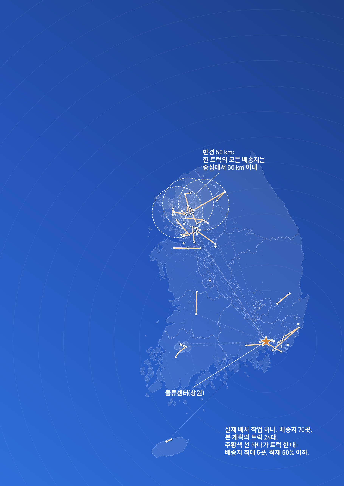

::: cover
::: cover-top
제2회 LogisticSolver 2026 스마트 물류 문제 해결 경진대회
:::

::: cover-title
대형 제품 배송을 위한 AI 기반 클러스터링 및 자동 배차
:::

::: cover-sub
후보를 추리는 그래프 신경망과 최종 결정을 내리는 정확 최적화기. 실제 배차 작업 97건과 공개 벤치마크로 검증
:::

::: cover-stats
[**−23.2%**]{.stat} [트럭: 2,517대에서 1,933대로]{.stat-l}

[**−21.2%**]{.stat} [도로 km: 655,444에서 516,628로]{.stat-l}

[**0.06%**]{.stat} [공개 벤치마크에서 증명된 최적해와의 평균 격차]{.stat-l}
:::

::: cover-art

:::

::: cover-team
**팀 ANALOG** (AI-based New Approach for LOGistics)

Ryry Rizky Asri (팀장), 정보통신공학과\
최영은, 전자공학과\
최정혜, 전자공학과

국립창원대학교, 2026년 11월
:::
:::

```{=openxml}
<w:p><w:r><w:br w:type="page"/></w:r></w:p>
```

::: contents
**목차**

1. 서론: 현장의 문제
2. 문제 정의
3. 데이터: 출처, 처리, 개인정보 보호
4. 방법과 각 단계가 필요한 이유
5. 구현과 코드
6. 실험 설계와 공정성
7. 결과: 절감, 정확도, 속도
8. 물류 KPI 기대 효과
9. 프로토타입
10. 도입 계획, 자원, 위험
11. 독창성과 차별성
12. 한계와 결론
:::

## 요약 {#summary}

창원 지역의 한 가전 제조사는 대형 제품(냉풍기, 대형 선풍기 등)을 물류센터 한 곳에서 전국의 고객에게 용차로 배송한다. 배차 작업마다 배차 담당자가 회사 규칙에 따라 배송 주소를 손으로 트럭에 나눈다. 규칙은 트럭당 주소 최대 5곳, 적재량은 적재함 부피의 60% 이하, 모든 주소는 묶음 중심에서 50 km 이내, 1.4톤 트럭은 작업당 최대 10대이다. 수작업으로 묶으면 필요보다 많은 트럭과 km가 든다.

본 팀은 묶음과 경로를 함께 정하는 배차 계획기를 만들었다. **그래프 신경망**(GNN)이 작업의 배송지를 읽고, 배송지마다 같은 트럭에 탈 가능성이 가장 높은 파트너 8곳만 남긴다. 학습에 쓰지 않은 작업에서 실제 파트너를 아닌 쌍보다 높게 순위 매길 확률은 74%이다(AUC 0.74). 이 후보 목록에서 회사 규칙을 지키는 모든 묶음이 후보 묶음이 된다. 이어서 **정확 최적화기**(혼합정수계획)가 후보 묶음 중에서 트럭 수가 가장 적고, 그중 실제 한국 도로 기준 km가 가장 짧은 조합을 고른다. 최종 계획의 모든 트럭은 모든 규칙에 대해 자동으로 검사된다.

2026년 4월~8월의 실제 배차 작업 97건(배송지 6,395곳)에서 이 계획은 회사 규칙을 모두 지키면서 [**트럭 2,517대 대신 1,933대(−23.2%)**]{.hl}를 쓰고 [**655,444 km 대신 516,628 km(−21.2%)**]{.hl}를 주행한다. 표준 경로 솔버인 Google OR-Tools는 같은 작업에 트럭 2,264대가 필요하다. 회사의 반경 규칙을 표현할 수 없기 때문이다. 계획 수립은 PC 한 대에서 [**작업당 6.8초**]{.hl}(중앙값)가 걸린다. 같은 최적화기에 최근접 15곳 목록을 쓸 때보다 10배 빠르고, 최근접 8곳 목록을 쓸 때보다 트럭이 적다. 최적화기의 정확도를 보이기 위해 30년간 차량 경로 연구에 쓰여 온 **공개 벤치마크**(CVRPLIB 세트 P [14])에서도 실행했다. 주소 5곳 규칙에 맞는 인스턴스 5개에서, 최근접 15곳 목록으로 4개는 증명된 최적해를 찾았고 나머지 하나는 0.3% 위였다. [**평균 0.06%**]{.hl}이다.

: 한눈에 보는 결과.

| KPI | 실제 배차 | 본 연구(GNN + 최적화기) | 변화 |
|---|--:|--:|--:|
| 트럭(실제 작업 97건) | 2,517 | **1,933** | **−23.2%** |
| 총 도로 km(실제 작업 97건) | 655,444 | **516,628** | **−21.2%** |
| 운행 시간(실제 작업 97건) | 8,880 | **7,163** | **−19.3%** |
| 작업당 계획 시간 | 수작업 | **6.8초**(중앙값) | |
| 증명된 최적해와의 격차(공개 벤치마크, 인스턴스 5개) | | 평균 **0.06%**(최적화기, 최근접 15곳 목록) | |

: 표 1. 이 보고서에서 쓰는 주요 용어.

| 용어 | 뜻 |
|---|---|
| 배차 작업, 배송지, 적재 묶음 | 함께 계획하는 배송의 묶음; 배송 주소 하나; 트럭 한 대가 맡는 배송지들 |
| 후보 목록 | 배송지마다 같은 트럭에 탈 수 있는 소수의 파트너. 이 파트너들로 만든 묶음만 고려한다 |
| 그래프 신경망(GNN) | 배송지와 이웃 간의 연결을 읽고, 두 배송지가 같은 트럭에 탈 가능성을 점수로 매기는 신경망 |
| MILP | 혼합정수선형계획: 예/아니요 결정을 포함하는 최적화 모델로, 솔버가 정확하게 푼다 |
| 벤치마크(CVRPLIB) | 최적해가 증명된 경로 문제를 모은 공개 라이브러리. 방법 비교에 쓰인다 |
| 최적성 격차 | 계획이 증명된 최적 계획보다 몇 % 나쁜지를 나타낸다. 0%면 최적이다 |
| AUC | 실제 쌍이 아닌 쌍보다 높게 순위 매겨질 확률(0.5는 무작위, 1.0은 완벽) |

# 1. 서론: 현장의 문제

**대형 배송은 트럭 단위로 계획된다.** 협력 기업은 창원의 물류센터에서 전국의 고객에게 대형 가전을 배송한다. 트럭과 기사는 외부 운송사에서 건별로 빌리므로 트럭이 모자랄 일은 없고, 문제는 몇 대로 해결하느냐이다. 일반적인 배차 작업에는 배송 주소가 63곳(8~141곳) 있고, 주소 한 곳에 약 0.9 m³, 즉 소형 트럭의 5분의 1 정도의 상자가 간다. 일반적인 주소 5곳이면 1톤 트럭이 이미 가득 차므로, 거의 모든 묶음은 부피 규칙이 결정한다.

**지금은 사람이 경험칙으로 묶는다.** 배차 담당자가 주소를 보고 가까운 곳끼리 트럭에 묶은 뒤, 적재량과 거리를 확인하고 차종을 정한다. 매일 시간이 들고, 사람에 따라 결과가 다르며, 계획이 최선과 얼마나 차이 나는지 아무도 알 수 없다.

**목표.** 다음을 만족하는 배차 계획기를 만든다. (1) 회사 규칙을 항상 지키고, (2) 트럭과 km를 최대한 줄이며, (3) 매일 쓸 만큼 빠르고, (4) 누구나 확인할 수 있는 공개 벤치마크에서 정확도를 측정할 수 있다. 표 2는 측정하는 KPI와 달성 결과이다.

: 표 2. 물류 KPI, 측정 방법, 결과.

| KPI | 측정 방법 | 목표 | 결과 |
|---|---|---|---|
| 트럭 | 97개 작업 전체에 쓰인 용차 대수 | 실제 배차보다 적게 | 1,933대(−23.2%) |
| 총 도로 km와 운행 시간 | 실제 도로망, 최적 방문 순서 | 더 적게 | 516,628 km(−21.2%); 시간 −19.3% |
| 규칙 준수 | 모든 트럭 자동 검사 | 100% | 100%(위반 0건) |
| 정확도 | 공개 벤치마크 인스턴스에서 증명된 최적해와의 격차 | 1% 이내 | 평균 0.06%; 5개 중 4개 최적 |
| 계획 시간(계획 리드타임) | PC 한 대에서 작업당 걸리는 초 | 1분 미만 | 중앙값 6.8초 |

**이 KPI를 고른 이유.** 가장 큰 비용은 트럭이다. 트럭 한 대가 곧 별도의 용차 한 건이다. km와 운행 시간은 연료와 기사의 시간을 정한다. 규칙 준수는 계획을 쓸 수 있는지를, 계획 시간은 일상 업무에 맞는지를 결정한다. 증명된 최적해 대비 정확도는 연구에서 경로 방법을 비교하는 방식이므로[10, 15], 심사자가 신뢰할 수 있는 척도이다.

**기존 접근.** 배송을 트럭에 묶고 방문 순서를 정하는 문제는 용량 제약 차량 경로 문제(CVRP)이다[10]. 고전 휴리스틱은 절약 알고리즘[11]처럼 가까운 배송지를 합쳐 경로를 만들거나, 먼저 군집화하고 나중에 경로를 짠다[12]. 빠르지만 계획이 최선과 얼마나 차이 나는지 알려 주지 않는다. 정확 해법은 집합 분할[2]과 정수계획으로 후보 경로 중에서 고르며, 열 생성[4]을 함께 쓰는 경우가 많다. 정확하지만 가능한 모든 경로를 고려해야 하면 느려진다. 경로를 직접 출력하는 신경망은 빠르지만[13] 적재 한도 같은 업무 규칙을 보장하지 못한다. 정확 솔버에 필요한 후보를 학습으로 고르는 방법[7]은 속도와 보장을 함께 얻는다. 본 팀의 이전 연구[1]는 이 회사의 묶음 작업을 규칙 기반 방법으로 자동화했다. 이 보고서는 새 배차 계획기를 실제 배차와 비교하여 제시한다.

**심사 기준과 보고서의 대응.** 문제 정의와 KPI: 1, 2장. 데이터 계획: 3장. 창의성과 차별성: 4, 11장. 실현 가능성(기술, 데이터, 일정, 위험): 5, 10장. 정량적 기대 효과: 8장.

# 2. 문제 정의

**배차 작업**은 함께 계획하는 배송의 묶음이다. **배송지**는 배송 주소 하나이다. **적재 묶음**(또는 클러스터)은 트럭 한 대가 맡는 배송지의 집합이다. 각 트럭은 물류센터에서 첫 배송지로 간 뒤 나머지를 차례로 돈다. 운송사를 편도로 빌리므로 물류센터로 돌아오지 않는다. 규칙은 회사의 제약 목록에서 왔으며 표 3에 정리했다.

: 표 3. 회사의 배차 규칙.

| 규칙 | 값 |
|---|---|
| 트럭당 주소 | 1~5곳 |
| 적재 한도 | 트럭 적재함 내부 부피의 60% 이하(안전 적재, 적층 없음) |
| 지역 | 모든 배송지가 묶음 중심에서 50 km 이내 |
| 여러 주소를 실을 수 있는 트럭 | 1톤(사용 가능 4.22 m³) 또는 1.4톤(사용 가능 4.73 m³) |
| 1.4톤 트럭 | 작업당 최대 10대 |
| 대형 트럭(2.5톤 이상) | 주소 한 곳만. 1.4톤에 실을 수 없는 배송지 132곳에 사용 |
| 차량 수 | 제한 없음(건별 용차) |
| 모든 배송지 | 정확히 한 번 배송 |


**목적.** 첫째, 트럭 수 최소. 둘째, 트럭 수가 최소인 계획 중에서 도로 km 최소. [*이 순서인 이유:*]{.why} 트럭 한 대는 별도의 용차 한 건이며, 몇 km 더 달리는 것보다 훨씬 비싸다. 트럭 수가 정해지면 km가 연료와 운행 시간을 결정한다.

**어려운 이유.** 가능한 묶음의 수가 폭발적으로 늘어난다. 배송지 63곳인 작업에는 5곳 이하 묶음이 약 770만 가지 있고, 가장 큰 작업(141곳)에는 정확히 5곳인 묶음만 약 4억 3,000만 가지가 있다. 모든 배송지를 정확히 한 번씩 덮는 묶음을 고르는 것은 고전적인 *집합 분할* 문제[2]이며 NP-난해이다. 규칙끼리도 얽혀 있다. 거리상 좋은 묶음이 부피 한도를 넘을 수 있고, 1.4톤 트럭 10대 한도는 한 작업의 모든 묶음을 서로 연결한다. 단순한 방법(탐욕 규칙, k-평균)은 규칙을 하나씩 다루므로 트럭을 낭비한다.

# 3. 데이터: 출처, 처리, 개인정보 보호

**출처와 법적 근거.** 모든 데이터는 이 프로젝트를 위해 동의를 받아 공유된 회사 자체 운영 기록이거나 공공 개방 데이터이다(표 4).

: 표 4. 데이터 출처.

| 데이터 | 출처 | 용도 |
|---|---|---|
| 배차 작업 97건, 배송지 6,395곳(2026년 4월 7일~8월 7일, 운영일 84일): 작업, 날짜, 주소 좌표, 주문 부피, 실제 트럭 묶음과 트럭 표시 | 회사 기록(비공개, 동의 하에 공유) | 계획 입력; 실제 배차 기준선 |
| 트럭 크기(8종, 적재함 내부 W × L × H) | 회사 트럭 목록 | 트럭별 사용 가능 부피 |
| 회사 배차 규칙 | 회사 제약 목록 | 표 3의 규칙 |
| 한국 도로망 | OpenStreetMap, 개방 라이선스(ODbL) [3] | 도로 km와 운행 시간 |
| 최적해가 증명된 벤치마크 인스턴스 | CVRPLIB 세트 P [14, 15], 공개 | 정확도 검증(7.2절) |
| 시도 경계 | 통계청 공공데이터 | 지도 표시 전용 |

::: figrow
{.map}

::: side
**설계 단계부터 개인정보 보호.** 원본 기록에는 고객 이름, 전화번호, 주소가 있다. 이 항목은 계획기가 전혀 쓰지 않으며 프로젝트 서버 밖으로 나가지 않는다. 도로 거리는 온라인 서비스가 아닌 자체 지도 서버에서 계산하므로 주소가 어디로도 전송되지 않는다. 이 보고서는 위치를 전국 규모로만, 표지 없이 보여 주며, 모든 예시는 합성 데이터를 쓴다.

**합성 샘플.** 데이터 형식을 보여 주고 고객 데이터 없이 코드를 실행할 수 있도록, 같은 형식의 합성 작업을 생성한다. 표 5는 그림 5와 표 13에 쓴 합성 작업의 처음 몇 행이다.

: 표 5. 합성 샘플(계획기 입력 형식).

| 배송지 | x (km) | y (km) | 부피 (m³) |
|---|--:|--:|--:|
| S01 | 40.0 | 33.3 | 0.94 |
| S02 | 37.0 | 20.2 | 1.24 |
| S03 | 35.0 | 19.1 | 0.81 |
| S04 | 40.7 | 44.7 | 1.31 |
| … | … | … | … |
| S26 | 138.4 | 101.8 | 0.73 |
:::
:::

**처리 흐름.** (1) 주문 내보내기 파일을 읽고 검사한다. 오타 수정으로 좌표가 정해진 배송지 9곳을 제외하여 6,395곳이 남는다. (2) 50 km 규칙을 위해 좌표를 평면 km 격자(EPSG:5179)로 투영한다. (3) 자체 지도 서버(프로젝트 서버에서 운영하는 OSRM [3])가 작업마다 물류센터와 모든 배송지 사이의 도로 km와 운행 시간을 계산한다. (4) 1.4톤 트럭에 실을 수 없는 배송지(132곳)는 정해진 규칙에 따라 더 큰 트럭을 단독으로 배정하고, 나머지 6,263곳을 계획기에 넘긴다. (5) 계획 결과는 배송지 ID와 숫자로만 저장한다.

**데이터 개요.** 작업당 배송지는 8~141곳(중앙값 63곳)이다. 배송지 부피의 중앙값은 0.90 m³, 합계는 8,990 m³이다. 1톤 트럭 한도 4.22 m³보다 큰 배송지가 169곳이다. 고객은 전국에 퍼져 있으며, 서울, 대구, 부산과 창원 주변에 밀집해 있다(그림 2).

**두 종류의 데이터를 쓰는 이유.** 실제 작업은 계획기가 현장에서 얼마나 절감하는지 보여 주지만, 그 최적 계획은 아무도 모른다. 공개 벤치마크 인스턴스는 최적해가 증명되어 있으므로 최적화기가 얼마나 정확한지 보여 준다. 서로가 보여 주지 못하는 부분을 채운다.

# 4. 방법과 각 단계가 필요한 이유

계획기는 배차 작업을 하나씩, 다섯 단계로 처리한다(그림 3). 각 도구는 가장 잘하는 일을 맡는다. AI 모델은 탐색 범위를 좁히고, 정확 최적화기는 결정을 내리며 규칙을 보장하고, 마지막 검사는 모든 트럭을 확인한다.

## 4.1 도로 거리

작업마다 자체 OSRM 서버[3]에 한 번 요청하면 물류센터와 모든 배송지 사이의 도로 거리와 운행 시간을 양방향으로 받는다. OSRM은 한국 OpenStreetMap 도로망에서 최단 경로를 계산한다. 드물게 도로로 연결되지 않은 쌍(섬)은 직선 거리의 1.3배를 시속 60 km로 계산한다.

[*이유:*]{.why} 트럭은 직선이 아니라 도로를 달린다. 산, 강, 해안 때문에 도로 거리는 직선 거리와 다르므로, 계획과 절감 효과 모두 도로 기준으로 측정해야 한다.


## 4.2 후보 묶음과 후보 목록

**후보 묶음**은 모든 규칙을 지키는 배송지 1~5곳의 묶음이다. 총 부피는 4.73 m³ 이하이고, 모든 배송지가 묶음 중심에서 50 km 이내이다. 큰 작업에서는 이를 모두 나열하면 너무 느리므로, 각 배송지는 가능성 높은 파트너의 **후보 목록**과만 묶음을 만든다. 즉 배송지 자신과 그 파트너 중 1~4곳이다. 최근접 15곳을 파트너로 쓰면 중앙값 작업의 후보 묶음은 19,280개이다. 파트너 8곳의 GNN 후보 목록을 쓰면 2,859개로 약 7배 적으며, 이것이 최적화기를 빠르게 만든다. 단순한 탐욕 계획을 항상 **안전망**으로 추가하므로, 최적화기는 언제나 유효한 계획을 반환할 수 있다.

[*이유:*]{.why} 큰 작업에는 가능한 묶음이 수억 개 있다. 후보 목록은 좋은 계획이 쓸 가능성이 높은 묶음만 남기며, 나열하는 단계에서 규칙을 적용하므로 어떤 후보도 규칙을 어기지 않는다.

## 4.3 GNN 후보 목록

GNN은 좋은 계획에서 두 배송지가 같은 트럭에 탈 가능성을 점수로 매긴다. 각 작업은 그래프이다. 배송지가 노드이고, 각 배송지는 최근접 12곳과 연결된다(100 km 넘게 떨어진 쌍은 같은 묶음이 될 수 없으므로 제외한다).

- **노드 특징(8개):** 1톤 트럭 대비 배송지 부피 비율, 작업 중심 기준 상대 위치(값 2개), 물류센터로부터의 도로 km, 가장 가까운 배송지와 4번째로 가까운 배송지까지의 거리, 작업 규모, 작업의 부피 압박(트럭 용량 대비 총 부피).
- **엣지 특징(4개):** 직선 거리, 도로 거리, 두 배송지의 합계 부피, 물류센터까지 거리의 차.
- **신경망:** 엣지 상태 메시지 전달[6], 4회 반복, 은닉 유닛 64개. 매 회 각 엣지가 양 끝 배송지와 자신의 상태로 메시지를 계산하고, 각 배송지는 들어온 메시지의 평균으로 자신을 갱신한다. 마지막의 작은 신경망이 쌍마다 확률 하나를 출력한다. 전체 파라미터는 137,857개이다.
- **학습 레이블:** 최적화기 자체의 계획에서 두 배송지가 같은 트럭에 타면 1이다. 손실 함수는 이진 교차 엔트로피, 학습 알고리즘은 AdamW(학습률 0.001)이며, GPU에서 전체 배치 400단계(몇 분)로 학습한다. 따라서 GNN은 최적화기를 넘어서는 것이 아니라 흉내 내도록 학습한다. 그 역할은 짧은 목록으로 올바른 파트너를 찾는 것이다. 7.1절에서 최근접 8곳 목록과 비교한다.


GNN은 결정이 아니라 순위 매기기에 쓰인다. 배송지마다 점수가 가장 높은 파트너 8곳을 남긴다. 정확 솔버에 필요한 후보를 학습하는 것은 이미 확립된 연구 방향이며[7], 여기서는 이를 회사 규칙에 적용했다.

[*GNN을 쓰는 이유:*]{.why} 좋은 파트너가 곧 가장 가까운 배송지는 아니다. 부피(큰 주문 두 개는 같은 트럭에 실을 수 없음), 도로 거리, 작업 전체의 적재 수준에도 달려 있다. 그래프 신경망은 배송지를 이웃과 함께 읽으므로 이 모든 요소로 한 번에 파트너 순위를 매길 수 있다. 그래서 파트너 8곳이 최근접 15곳을 대신할 수 있다.

## 4.4 정확 선택

각 후보 묶음 $c$에 대해, 배송지 $i$가 $c$에 있으면 $a_{ic}=1$, $c$에 배송지가 여러 곳이고 1.4톤 트럭이 필요하면 $h_c=1$이며, $d_c$는 그 최적 경로의 도로 km이다. 예/아니요 변수 $x_c$는 묶음 $c$의 사용 여부를 나타낸다. 최적화기는 HiGHS 솔버[5]로 혼합정수계획(MILP) 두 개를 푼다.

$$\text{(A)}\quad T^\ast=\min \sum_c x_c \quad\text{s.t.}\quad \sum_c a_{ic}\,x_c = 1\ \ \forall i,\qquad \sum_c h_c\,x_c \le 10,\qquad x_c\in\{0,1\}$$

$$\text{(B)}\quad \min \sum_c d_c\,x_c \quad\text{s.t. (A)의 제약과}\quad \sum_c x_c = T^\ast$$

A단계는 최소 트럭 수를 찾고, B단계는 그런 계획 중 km가 가장 적은 것을 찾는다. $d_c$가 각 묶음의 최적 경로 길이이므로 **묶음과 경로가 함께 결정된다.** 각 단계의 시간 제한은 60초이며, 그때까지 솔버가 안전망보다 나은 해를 찾지 못하면 안전망을 반환한다. *정확*이란 후보 묶음 중 최선의 조합이라는 뜻이다. 후보 목록에 없는 묶음은 고려하지 않으므로, 작업 전체에서 가능한 최선의 계획임이 증명된 것은 아니다.

[*정확 최적화를 쓰는 이유:*]{.why} 탐욕 방법은 트럭을 한 대씩 정하고 선택을 되돌릴 수 없으므로, 마지막 배송지들이 반쯤 빈 트럭에 남기 쉽다. MILP는 모든 후보 묶음을 한꺼번에 저울질하며, 제약식이 구조적으로 모든 규칙을 보장한다.

## 4.5 트럭 내 경로

트럭 한 대의 배송지는 최대 5곳이므로 가능한 방문 순서는 최대 120가지이다. 모든 순서를 실제 도로 거리(물류센터 → 첫 배송지 → … → 마지막 배송지)로 평가하므로, 모든 트럭의 방문 순서는 도로 데이터 기준으로 정확히 최적이다. 벡터화된 배열 연산으로 모든 후보 묶음을 한 번에 처리한다.

[*이유:*]{.why} 배송지가 5곳이면 모든 순서를 시도해도 비용이 적으므로, 근사 경로를 받아들일 이유가 없다.

## 4.6 규칙 검사

계획을 받아들이기 전에 자동 검사가 다음을 확인한다. 모든 배송지가 정확히 한 번 배송되는지, 배송지가 5곳을 넘거나 부피 한도를 넘거나 중심에서 50 km 넘게 떨어진 배송지가 있는 트럭은 없는지(코드 3), 한 작업에 1.4톤 트럭이 10대 이하인지 확인한다. 하나라도 실패하면 실행을 멈춘다.

[*이유:*]{.why} 규칙을 하나라도 어긴 계획은 쓸 수 없다. 검사는 최적화기와 독립적이므로 최적화기 자체의 버그도 잡아낸다.

## 4.7 예제

그림 5는 표 5의 합성 작업에 실제 코드를 실행한 결과이다. 배송지는 26곳이고, 배송지마다 최근접 파트너 8곳에서 후보 묶음 1,494개를 만든다. 최적화기는 트럭 6대, 1,029 km를 고른다. 총 부피가 25.6 m³이고 트럭 한 대가 최대 4.73 m³를 실으므로 6대보다 적은 계획은 불가능하다. 즉 이 계획은 트럭 수에서 가능한 최선임이 증명된다. 표 13(9장)은 배차 담당자가 이 작업에 대해 받는 배차표이다.


# 5. 구현과 코드

계획기는 약 1,200줄의 Python 코드이다. 표 6은 사용 기술이며, 모두 무료 오픈 소스로 일반 PC 한 대에서 실행된다.

: 표 6. 기술 스택.

| 구성 요소 | 기술 |
|---|---|
| 언어와 수치 계산 | Python 3.12, NumPy, SciPy [8] |
| 최적화기 | SciPy를 통한 HiGHS MILP 솔버 [5] |
| AI 모델 | PyTorch [9], 순수 메시지 전달 구현(그래프 라이브러리 없음) |
| 도로 거리 | Docker 기반 OSRM 5.27, OpenStreetMap 한국 [3] |
| 병렬 실행 | 8코어 CPU에서 작업 프로세스 7개; 23 GB GPU 1개는 학습에만 사용 |
| 테스트 | 작은 사례에서 전수 탐색과 비교하는 단위 테스트; 모든 계획에 자동 규칙 검사 |
| 프로토타입 | 비밀번호로 보호되는 정적 웹 페이지(HTML, JavaScript, SVG), 외부 서비스 없음 |

핵심 부분을 줄여서(주석, 로그, 부수 처리 제거) 아래에 싣는다.

**코드 1. GNN 순전파 한 번:** 엣지 상태 메시지 전달 4회 후 쌍마다 점수 하나.

```python
def forward(s, X, E, a, b):                       # X: 배송지 특징, E: 쌍 특징, a -> b: 연결
    h, e = s.nx(X), s.ne(E)                       # 배송지와 쌍 인코딩
    deg = torch.bincount(b, minlength=len(X)).clamp(min=1).unsqueeze(1)
    for msg, upd, nrm in zip(s.msg, s.upd, s.nrm):
        m = msg(torch.cat([h[a], h[b], e], 1))    # 연결마다 메시지
        e = e + m                                 # 연결이 메시지를 기억
        agg = torch.zeros_like(h).index_add_(0, b, m) / deg
        h = nrm(h + upd(torch.cat([h, agg], 1)))  # 각 배송지가 평균 메시지로 갱신
    return s.head(torch.cat([h[a], h[b], e], 1)).squeeze(1)   # 쌍마다 점수 하나
```

**코드 2. 정확 선택**(A단계: 최소 트럭; B단계: 그 대수에서 최소 km).

```python
# A: 배송지마다 한 행(정확히 한 번 배정), 1.4톤 한도에 한 행
cons = [LinearConstraint(A, 1, 1), LinearConstraint(t14[None], 0, MAX14)]
res = milp(np.ones(m), integrality=np.ones(m), bounds=Bounds(0, 1),
           constraints=cons, options={"time_limit": 60})
k = int(round(res.x.sum()))                            # 찾은 최소 트럭 수
res2 = milp(km_per_load, integrality=np.ones(m), bounds=Bounds(0, 1),
            constraints=cons + [LinearConstraint(np.ones((1, m)), k, k)],
            options={"time_limit": 60})
plan = [loads[j] for j in np.flatnonzero(res2.x > 0.5)]
```

**코드 3. 규칙 검사.** 모든 계획은 받아들여지기 전에 이 검사를 통과한다.

```python
def check(xy, v, C, R, clusters):
    assert np.array_equal(np.sort(np.concatenate(clusters)), np.arange(len(xy))), "every stop exactly once"
    for c in clusters:
        assert len(c) <= K and v[c].sum() <= C and radius(xy, np.array([c]))[0] <= R, c
```

**정확성 검사.** 후보 나열과 최적화기를 무작위 소규모 작업에서 전수 탐색(가능한 모든 계획)과 비교한다. 벤치마크 스크립트는 공개된 최적해마다 본 팀의 거리 코드로 비용을 다시 계산하고, 값이 다르면 멈춘다. 따라서 본 팀의 거리는 벤치마크의 거리와 일치한다. 전체 코드와 합성 데이터 생성기는 팀이 보관하며, 요청 시 심사위원에게 제공할 수 있다.

# 6. 실험 설계와 공정성

**작업.** 실제 배차 작업 97건 전체. 모든 방법에서 각 작업을 물류센터 기준으로 따로 계획하고, 같은 도로 거리와 같은 규칙을 적용한다.

**비교 방법과 선정 이유.**

- *실제 배차:* 실제로 운행한 묶음을 같은 도로 기준으로 측정한다. 계획기가 넘어서야 할 현행 방식이다.
- *k-평균:* 가장 널리 쓰이는 군집화 방법으로, 규칙을 어기는 곳마다 분할한다. 회사가 가장 먼저 시도할 방법이다.
- *병합 군집화:* 규칙을 지키는 동안 도로 km 기준으로 가장 가까운 두 묶음을 반복해서 합친다. 합치는 동안 규칙을 지키는, 더 강한 고전 방법이다.
- *OR-Tools:* Google의 오픈 소스 경로 솔버[16]로, 개발자가 가장 먼저 찾을 표준 도구이다. 부피와 5곳 한도, 편도 경로, 트럭 수를 먼저 줄이도록 트럭당 고정 비용, 작업당 30초의 유도 지역 탐색(guided local search)을 설정했다. 50 km 반경 규칙은 표현할 수 없으므로, 이를 어기는 경로는 k-평균과 같은 보정으로 분할한다.
- *최적화기, 최근접 15곳 목록:* 단순 최근접 후보를 쓰는 본 최적화기, 단계당 60초. 풀 수 있는 가장 정확한 목록이지만 느리다.
- *최적화기, 최근접 8곳 목록:* GNN과 같은 목록 크기로 최근접 8곳을 쓴다. GNN의 파트너 선택이 더하는 효과만 분리한다.
- *GNN + 최적화기(본 계획기):* 파트너 8곳의 GNN 후보 목록, 단계당 60초.

**정확도 벤치마크.** CVRPLIB[15]는 이 문제 유형의 표준 라이브러리이다. 세트 P(Augerat 외[14])에는 최적해 또는 최고 기록해가 공개된 인스턴스 24개가 있으며, 그중 어떤 5개를 쓰는지는 7.2절에서 설명한다. 코드는 동일하다. 고객마다 최근접 파트너 15곳으로 후보를 만들고, 차량 수 최소, 다음 거리 최소 순으로 단계당 60초 동안 푼다. 거리는 CVRPLIB 규약(반올림한 직선 거리, 물류센터 왕복, 반경 규칙 없음)을 따른다.

**정보 누출 방지.** GNN은 *폴드 외*(out-of-fold) 방식으로 평가한다. 97개 작업을 날짜순으로 연속된 블록 5개로 나누고, 각각 블록 4개로 모델 5개를 학습한 뒤, 모든 작업은 그 블록을 본 적 없는 모델로 계획한다.

: 표 7. 흔한 오류를 막는 평가 장치.

| 우려 | 대응 |
|---|---|
| 쉬운 작업만 시험함 | 실제 작업 97건 전체, 제외 없음 |
| 방법마다 조건이 다름 | 모든 방법에 같은 도로, 규칙, 시간 제한 |
| 규칙을 어겨서 좋아 보이는 계획 | 모든 계획에 자동 규칙 검사: 위반 0건 |
| AI 모델이 시험 작업을 이미 봄 | 폴드 외 평가: 모든 작업은 해당 날짜 블록을 본 적 없는 모델로 계획 |
| 본 팀만 확인할 수 있는 정확도 | 누구나 다시 실행할 수 있고 최적해가 증명된 공개 벤치마크 |
| 오해를 부르는 정확도 수치 | 정확도와 기본 정확도 옆에 AUC를 함께 보고 |

**지표.** 트럭 수, 총 도로 km와 운행 시간(OSRM 기준), 규칙 위반, 벤치마크의 최적성 격차, CPU 코어 하나에서의 작업당 계획 시간, GNN의 쌍 정확도와 AUC. [*정확도만이 아니라 AUC를 보는 이유:*]{.why} 같은 트럭에 타는 배송지 쌍은 약 19%뿐이므로, 항상 "다른 트럭"이라고 답하는 모델도 정확도가 81%이다. 이 **기본 정확도**는 모델에 대해 아무것도 말해 주지 않는다. AUC는 순위를 측정하며, 후보 목록에 필요한 것은 순위뿐이다.

# 7. 결과: 절감, 정확도, 속도

## 7.1 트럭과 km

: 표 8. 97개 작업에서 모든 방법의 결과.

| 방법 | 트럭 | 실제 배차 대비 | 총 도로 km | 실제 배차 대비 | 운행 시간(h) | 1.4톤 사용 |
|---|--:|--:|--:|--:|--:|--:|
| 실제 배차 | 2,517 | 0% | 655,444 | 0% | 8,880 | 해당 없음 |
| k-평균 | 2,702 | +7.4% | 680,366 | +3.8% | 9,170 | 587 |
| 병합 군집화 | 2,235 | −11.2% | 575,984 | −12.1% | 7,844 | 517 |
| OR-Tools(작업당 30초) | 2,264 | −10.1% | 577,639 | −11.9% | 7,936 | 457 |
| 최적화기, 최근접 15곳 목록 | 1,920 | −23.7% | 526,087 | −19.7% | 7,303 | 808 |
| 최적화기, 최근접 8곳 목록 | 1,941 | −22.9% | 518,682 | −20.9% | 7,185 | 825 |
| **GNN + 최적화기(본 연구)** | **1,933** | **−23.2%** | **516,628** | **−21.2%** | **7,163** | **845** |


**결과가 보여 주는 것.**

- **트럭을 줄이는 것은 최적화기이다.** 최적화기를 쓴 모든 행은 다른 모든 방법보다 트럭이 294대 이상 적다. 본 계획은 실제 배차보다 트럭이 584대 적다.
- **트럭과 함께 총 거리도 줄어든다.** 본 계획은 실제 배차보다 도로 km가 138,816 km 적다(−21.2%). B단계에서 각 묶음의 비용이 실제 도로상의 최적 경로이기 때문이다. 모든 방법 중 km도 가장 적다.
- **GNN이 더하는 것.** 목록 크기가 같을 때, GNN이 고른 파트너는 최근접 8곳보다 트럭이 8대, km가 2,054 km 적다(9개 작업에서 적고 2개에서 많음). 작업당 약 1초가 더 든다. 최근접 15곳 목록보다는 트럭이 13대(0.7%) 많지만 10배 빠르게 푼다(7.3절). 단순 최근접 대비 이득은 작지만 실재한다.
- **고전 군집화로는 부족하다.** k-평균은 부피 규칙을 무시하므로 묶음을 분할해야 하고, 결국 실제 배차보다 나빠진다. 병합 군집화는 더 낫지만 여전히 본 계획보다 트럭이 302대 많다.
- **표준 경로 솔버로도 부족하다.** OR-Tools는 반경 규칙을 표현할 방법이 없다. 97개 작업 중 89개에서 경로 262개가 이 규칙을 어겨 분할해야 했다. 최종 계획은 본 계획보다 트럭이 331대 많다(92개 작업에서 많고, 적은 작업은 없음). 그 차이의 상당 부분은 보정에서 생기며, 바로 그것이 요점이다. 회사 규칙은 나중에 고치는 것이 아니라 모델 안에 들어 있어야 한다.
- **실제 배차는 데이터에 없는 사항도 처리했다.** 배차 담당자는 고객의 시간 요청, 기사 사정, 특수 취급도 고려한다. 실제 묶음 중 230개는 명문화된 규칙 밖에 있으며(예: 50 km보다 넓음), 이는 그런 운영상의 이유를 시사한다. 절감은 그런 예외에서 오지 않는다. 모든 실제 묶음이 명문화된 규칙을 지키는 13개 작업에서도 본 계획은 트럭이 28.2% 적고(291대 대비 209대), km가 24.9% 적다. 그 작업에도 시간 요청은 있을 수 있으며, 시범 운영(10장)에서 측정할 것이다.


::: figrow
{.half}

::: side
**작업별 결과.** 절감은 거의 모든 작업에 고르게 퍼져 있다. 본 계획은 [**97개 작업 중 93개**]{.hl}에서 실제 배차보다 트럭이 적고, 3개에서 같으며, 1개에서 1대 많다(그림 8). 한 작업에서 가장 큰 절감은 5월 초의 24대이다.

**절감이 생기는 곳.** 큰 작업일수록 많이 절감한다(그림 7). 배송지가 중앙값 63곳보다 많은 작업은 평균 7.9대(트럭의 24.6%), 작은 작업은 4.1대(20.9%)를 절감한다. 큰 작업일수록 배송지를 조합하는 방법이 많고, 최적화기는 이를 활용하지만, 사람이 만든 계획은 그 모두를 저울질할 수 없다.
:::
:::

## 7.2 정확도

**공개 벤치마크에서의 정확도.** 표 9는 증명된 최적 경로가 고객을 5곳 이하로 방문하는 세트 P의 모든 인스턴스에서의 최적화기 결과이다. 이 기준으로 5개가 정해졌고, 모두 보고한다. 나머지 19개는 더 긴 경로가 필요하므로 주소 5곳 규칙에 맞지 않는다. 최적화기는 4개에서 증명된 최적해를 찾고, P-n55-k15에서는 거리 3단위(0.3%) 위이다. 평균 격차는 [**0.06%**]{.hl}이다. 5개 모두에서 최적해와 같은 차량 수를 쓰며, 어떤 인스턴스도 17초를 넘지 않는다. 비교하면, 인스턴스당 30초를 쓴 OR-Tools는 3개에서 최적해를 찾고, P-n60-k15에서 3.8% 위이며, P-n55-k15에서는 차량이 1대 더 필요하다.

: 표 9. 공개 벤치마크(CVRPLIB 세트 P [14])에서의 최적화기. 격차 = (본 거리 − 증명된 최적해) / 증명된 최적해.

| 인스턴스 | 고객 수 | 차량 수(최적해 / 본 연구) | 후보 묶음 | 증명된 최적해 | 본 거리 | 격차 | 시간 |
|---|--:|--:|--:|--:|--:|--:|--:|
| P-n16-k8 | 15 | 8 / 8 | 164 | 450 | 450 | 0.0% | 0.1초 |
| P-n22-k8 | 21 | 8 / 8 | 1,569 | 603 | 603 | 0.0% | 0.9초 |
| P-n23-k8 | 22 | 8 / 8 | 1,243 | 529 | 529 | 0.0% | 0.3초 |
| P-n55-k15 | 54 | 15 / 15 | 8,927 | 989 | 992 | 0.3% | 7.2초 |
| P-n60-k15 | 59 | 15 / 15 | 20,186 | 968 | 968 | 0.0% | 16.8초 |

**벤치마크가 보여 주는 것과 보여 주지 않는 것.** 인스턴스는 작고(고객 15~59곳), 경로가 고객 5곳 이하이므로 최근접 15곳 목록에 쓸모 있는 경로가 거의 모두 들어간다. 따라서 이 벤치마크는 최적화기와 거리 코드가 올바르고 거의 정확함을 확인할 뿐, 어려운 시험은 아니다. 목록이 짧으면 정확도가 떨어진다. 최근접 파트너 8곳으로도 최적화기는 3개 인스턴스에서 최적해를 찾지만, P-n23-k8에서 10.4% 위이고 P-n55-k15에서 차량이 1대 더 필요하다. GNN은 회사의 도로 km와 m³ 부피로 학습했으므로 벤치마크에서는 실행하지 않았다. 실제 작업에서 GNN 파트너 8곳은 최근접 15곳 목록 대비 트럭 0.7%를 잃는 반면, 최근접 8곳은 1.1%를 잃는다.

**GNN 자체의 정확도.** 학습에 쓰지 않은 배송지 쌍 43,927개에서 순위 품질은 [**AUC 0.74**]{.hl}이다(0.5는 무작위). 올바른 파트너가 목록 위쪽에 있다는 뜻이다. 정확도 81.8%는 기본 정확도 81.3%보다 조금 높을 뿐이며, 순위 모델에서는 예상되는 결과이다(6장). 표 10은 날짜 블록별로 둘을 보여 준다.

: 표 10. 날짜 블록별 GNN 점수(해당 블록을 보지 않은 모델 기준).

| 블록 | 날짜(2026) | 작업 | 배송지 쌍 | 정확도 | 기본 정확도 | AUC |
|--:|---|--:|--:|--:|--:|--:|
| 1 | 04-07~05-04 | 20 | 7,495 | 85.1% | 85.1% | 0.76 |
| 2 | 05-06~05-29 | 19 | 9,998 | 82.8% | 81.9% | 0.75 |
| 3 | 06-01~06-29 | 20 | 8,893 | 80.6% | 80.0% | 0.73 |
| 4 | 06-30~07-22 | 19 | 9,782 | 81.7% | 81.5% | 0.68 |
| 5 | 07-23~08-07 | 19 | 7,759 | 78.4% | 77.8% | 0.76 |

순위 품질은 모든 블록에서 비슷하므로(AUC 0.68~0.76) GNN은 특정 달에 의존하지 않는다. **규칙 준수:** 모든 계획이 모든 규칙을 지킨다. 트럭 1,933대에서 위반 0건이다.

## 7.3 속도

: 표 11. 작업당 계획 시간(작업당 CPU 코어 하나).

| 최적화기 후보 | 중앙값 | 가장 느린 작업 | 60초 한도 도달 | 트럭 |
|---|--:|--:|--:|--:|
| 최근접 15곳 목록 | 67.2초 | 141초 | 13개 작업 | 1,920 |
| 최근접 8곳 목록 | 5.8초 | 72초 | 0개 작업 | 1,941 |
| GNN 후보 목록(본 연구) | **6.8초** | 120초 | 2개 작업 | 1,933 |

GNN 후보 목록은 최근접 15곳 계획과 0.7% 이내의 계획을 **10분의 1 시간**에 내며, 솔버 시간 한도에 거의 걸리지 않는다. 일상 배차에서는 몇 초 만에 최적에 가까운 계획을 얻는다는 뜻이다.


속도 향상은 소형과 중형 작업에서 가장 크다. 배송지 50곳 미만 작업에서 풀이 시간 중앙값은 GNN 목록이 1.4초, 최근접 15곳 목록이 18.6초이다. 배송지 100곳 이상인 작업 8개에서는 두 목록 모두 더 오래 걸리며(중앙값 62.7초 대 114.7초), 단계당 60초 한도와 안전망이 시간을 제한한다.

# 8. 물류 KPI 기대 효과

**계산 근거.**

- **트럭, 도로 km, 운행 시간:** 97개 작업에서 직접 측정했다(7장).
- **연간:** 97개 작업은 123일(4월 7일~8월 7일)에 걸쳐 있으므로, 연중 주문량이 같다고 가정하고 365 / 123 = 2.97을 곱한다. 4월~8월은 냉풍기와 선풍기의 성수기이므로 연간 수치는 **상한**이다.
- **용차 비용(추정):** 두 계획의 모든 트럭에 국내 화물 중개 업체 두 곳의 공개 편도 정가를 적용했다(2026년 11월 11일 조회, 차종별 기본 운임과 km당 요금, 추가 주소당 경유 요금). 회사 계약 단가가 아닌 정가이며, 두 가격표에서 각각 −14.5%와 −14.4%가 나온다. 운임이 주로 거리에 따라 정해지므로 금액 절감은 트럭 절감보다 작다. 본 목적 함수는 트럭 수를 먼저 세며, 추정 비용을 직접 최소화하도록 바꿀 수도 있다.

: 표 12. 실제 배차 대비 기대 절감.

| KPI | 4개월(작업 97건) | 연간(상한) |
|---|--:|--:|
| 용차 트럭 | 584대 감소(−23.2%) | 약 1,700대 감소 |
| 총 도로 km | 138,816 km 감소(−21.2%) | 약 412,000 km 감소 |
| 운행 시간 | 1,717시간 감소(−19.3%) | 약 5,100시간 감소 |
| 용차 비용(추정) | 약 6,200만 원 감소(−14.5%) | 약 1억 8,000만 원 감소 |
| 계획 시간 | 작업당 수작업 수 분 | 작업당 6.8초 |

트럭이 줄면 예약하고 조율할 기사도, 하루 물류센터 상차 슬롯도, 작업당 배차 담당자의 시간도 줄어든다.

# 9. 프로토타입

모든 계획을 보여 주는 대화형 웹 프로토타입을 만들었다. 주요 수치, 전체 방법 비교, 작업별 차트, 그리고 모든 작업의 트럭을 차종, 적재량, km, 시간과 함께 지도에 보여 주는 탐색기가 있다. 고객 위치를 보여 주므로 비밀번호로 보호하며, 외부 지도나 추적기를 불러오지 않는다. 발표에서 직접 시연할 예정이다.

**배차 담당자의 사용 방식.** 계획기는 기존 업무에 그대로 들어간다(그림 10). 회사가 이미 만드는 주문 내보내기 파일을 넣으면, 배차 담당자가 확인하고 바로 예약할 수 있는 배차표가 나온다. 표 13은 그림 5의 합성 작업에 대한 배차표로, 트럭마다 방문 순서대로의 배송지, 차종, 적재율을 보여 준다.


: 표 13. 합성 작업에 대한 계획기 출력(배송지 26곳에 트럭 6대).

| 트럭 | 방문 순서대로의 배송지 | 부피 (m³) | 차종 | 60% 한도 대비 | km(합성) |
|---:|------------------------|-----:|-----:|-----:|-----:|
| 1 | S03 → S05 → S01 → S08 → S04 | 4.55 | 1.4톤 | 96% | 87 |
| 2 | S02 → S07 → S06 | 4.52 | 1.4톤 | 96% | 79 |
| 3 | S10 → S14 → S11 → S09 → S12 | 3.95 | 1톤 | 93% | 156 |
| 4 | S16 → S17 → S20 → S21 → S19 | 4.41 | 1.4톤 | 93% | 184 |
| 5 | S13 → S15 → S26 → S23 | 4.66 | 1.4톤 | 98% | 239 |
| 6 | S18 → S22 → S25 → S24 | 3.50 | 1톤 | 83% | 283 |


# 10. 도입 계획, 자원, 위험

**회사에 필요한 것.** 사무용 PC 또는 소형 서버 한 대(CPU 8코어, 메모리 16~32 GB). GPU는 모델 재학습에만 필요하며, 몇 분이면 끝나므로 아무 GPU 장비에서나 매달 할 수 있다. 도로 지도는 무료 OpenStreetMap 데이터로 매달 갱신한다. 입력은 기존 주문 내보내기 파일(엑셀)이고, 출력은 트럭별 계획(방문 순서, 차종, km, 시간)으로 엑셀과 웹 페이지에 제공한다.

[*먼저 섀도 모드로 운영하는 이유:*]{.why} 계획은 명문화된 규칙을 지키지만, 배차 담당자는 데이터에 없는 사항도 안다(7.1절). 나란히 운영하면 계획으로 트럭을 예약하기 전에 그 차이가 드러난다.

: 표 14. 시범 운영 일정.

| 단계 | 시기 | 내용 | 성공 지표 |
|---|---|---|---|
| 0. 준비 | 2026년 12월(2주) | 회사 PC에 설치, 주문 내보내기 파일 연결, 과거 전체 작업으로 모델 학습 | 과거 모든 작업에 대한 계획 생성 |
| 1. 섀도 모드 | 2027년 1월(4주) | 계획기가 매일 배차 담당자와 나란히 실행. 계획은 비교만 하고 쓰지 않음 | 수작업 계획 대비 작업당 트럭과 km; 배차 담당자 의견 |
| 2. 보조 모드 | 2027년 2~3월 | 배차 담당자가 계획기의 계획에서 시작해 수정 | 수정이 적은 계획의 비율; 트럭, km, 시간 |
| 3. 검토 | 2027년 4월 | 전면 도입 결정; 1~2단계에서 파악한 규칙 추가 | 이 보고서의 추정치 대비 측정된 절감 |

: 표 15. 위험과 대응.

| 위험 | 대응 |
|---|---|
| 데이터에 없는 규칙(고객 시간 요청, 기사 근무 시간, 특수 취급) | 섀도 모드와 보조 모드를 먼저 운영; 각 규칙을 최적화기의 제약으로 추가(추가 선형 규칙은 그대로 처리 가능) |
| 주소 또는 좌표 오류 | 지역에서 멀리 떨어지거나 같은 지점을 공유하는 배송지를 표시; 배차 담당자가 계획 전에 수정 가능 |
| 매우 큰 날은 풀이가 오래 걸림 | 안전망과 함께 시간 제한(유효한 탐욕 계획이 항상 있음); GNN 후보 목록으로 중앙값을 수 초로 유지 |
| 배차 담당자의 신뢰 | 모든 계획을 전체 규칙으로 검사하고 지도에 표시; 최종 결정은 배차 담당자가 내림 |
| 개인정보 | 모든 처리가 회사 자체 컴퓨터에서 이루어지며, 주소를 온라인 서비스로 보내지 않음(개인정보 보호법 준수) |
| 모델 성능 저하(신제품, 새 지역) | 새 작업으로 매달 재학습; 최적화기와 규칙 검사는 모델이 틀려도 영향을 받지 않음 |

**확장.** 방법의 어떤 부분도 한 회사에 국한되지 않는다. 규칙은 파라미터(트럭당 주소 수, 적재 한도, 반경, 트럭 목록, 1.4톤 대수 한도)이다. 가구, 가전, 건축 자재처럼 대형 화물을 용차로 배송하는 모든 화주나 운송사가 쓸 수 있으며, 같은 설계는 지역과 부피로 화물을 묶는 항만 및 내륙 운송 구간에도 맞는다.

# 11. 독창성과 차별성

**이 문제에서 새롭다고 보는 점.** (1) 대형 배송의 묶음과 경로를 회사의 전체 규칙 아래에서 정확 최적화기로 함께 결정한다. (2) 최적화기 자체의 계획으로 학습한 GNN을 계획 수립이 아닌 후보 추리기에 써서, 규칙 보장을 유지하면서 속도를 얻는다. (3) 실제 배차를 기준선으로 한 실제 운영 데이터 검증과, 정확도를 뒷받침하는 공개 벤치마크. 정확 솔버의 후보를 신경망으로 추리는 것 자체는 확립된 연구이며[7], 본 팀은 이를 적용한 것이지 새로 제안했다고 주장하지 않는다.

: 표 16. 현행 방식과의 차이.

| | 수작업 배차 | 본 연구 |
|---|---|---|
| 묶음 선택 방식 | 경험 | 수천 개 후보 묶음에 대한 정확 최적화 |
| 경로 | 별도 단계 | 묶음과 함께 결정; 실제 도로 기준 정확한 방문 순서 |
| 규칙 준수 | 자동 검사 없음 | 항상, 모든 트럭 자동 검사 |
| 정확도 근거 | 없음 | 공개 벤치마크에서 증명된 최적해와 평균 0.06% 격차 |
| AI의 역할 | 없음 | GNN 후보 목록이 정확 최적화를 10배 빠르게 하고, 최근접 배송지보다 나은 파트너를 고름 |
| 속도 | 작업당 수 분 | 작업당 수 초(중앙값 6.8초) |
| 개인정보 | 해당 없음 | 자체 지도 서버; 주소가 회사 밖으로 나가지 않음 |

# 12. 한계와 결론

**한계.** 계획은 명문화된 규칙을 따르며, 시간 창, 기사 근무 시간, 하차 제약은 아직 데이터에 없다. 1.4톤 트럭 10대 한도는 작업당으로 가정했다. 데이터는 한 회사의 성수기 4개월이므로 연간 수치는 상한이며, 물류센터는 해당 구의 중심에 두었다. *정확*은 후보 묶음 안에서 정확하다는 뜻이지, 작업 전체에서 가능한 최선의 계획이라는 증명이 아니다. 벤치마크는 반경 규칙 없는 왕복 경로에서, 그리고 최적 경로가 고객 5곳 이하인 인스턴스에서만 최적화기를 시험한다. GNN은 벤치마크가 아닌 실제 작업에서 시험했으며, 최근접 8곳 대비 이득은 작다(97개 작업에서 트럭 8대). OR-Tools는 작업당 30초의 표준 탐색으로 실행했으며, 시간을 늘리거나 조정하면 격차가 줄어들 수 있다.

**결론.** 그래프 신경망 후보 목록으로 빨라진 정확 최적화는 회사의 모든 규칙을 지키면서 실제 배차보다 트럭을 23%, 도로 km를 21% 줄여 대형 배송을 계획한다. 공개 벤치마크에서 같은 최적화기는 5개 인스턴스 중 4개에서 증명된 최적해를 찾고, 평균 격차는 0.06%이다. PC 한 대에서 수 초 만에 실행되고, 고객 데이터를 회사 안에 두며, 섀도 모드 시범 운영을 바로 시작할 수 있다.

## 참고문헌

::: refs
[1] R. R. Asri, A. B. Wahyutama, M. Hwang and K. Jin, "Automated Clustering and Vehicle Dispatching Service for Bulky Product Delivery," *2026 IEEE Int. Conf. on Industry 4.0, Artificial Intelligence, and Communications Technology (IAICT)*, 2026. doi:10.1109/IAICT71158.2026.11621014.

[2] M. L. Balinski and R. E. Quandt, "On an integer program for a delivery problem," *Operations Research*, 12(2), 300-304, 1964.

[3] D. Luxen and C. Vetter, "Real-time routing with OpenStreetMap data," *Proc. ACM SIGSPATIAL GIS*, 513-516, 2011; map data © OpenStreetMap contributors, ODbL.

[4] A. A. Farley, "A note on bounding a class of linear programming problems, including cutting stock problems," *Operations Research*, 38(5), 922-923, 1990.

[5] Q. Huangfu and J. A. J. Hall, "Parallelizing the dual revised simplex method," *Mathematical Programming Computation*, 10, 119-142, 2018 (HiGHS).

[6] J. Gilmer, S. S. Schoenholz, P. F. Riley, O. Vinyals and G. E. Dahl, "Neural message passing for quantum chemistry," *Proc. ICML*, 2017.

[7] M. Morabit, G. Desaulniers and A. Lodi, "Machine-learning-based column selection for column generation," *Transportation Science*, 55(4), 815-831, 2021.

[8] P. Virtanen et al., "SciPy 1.0: fundamental algorithms for scientific computing in Python," *Nature Methods*, 17, 261-272, 2020.

[9] A. Paszke et al., "PyTorch: an imperative style, high-performance deep learning library," *Advances in NeurIPS*, 32, 2019.

[10] P. Toth and D. Vigo (eds.), *Vehicle Routing: Problems, Methods, and Applications*, 2nd ed., SIAM, 2014.

[11] G. Clarke and J. W. Wright, "Scheduling of vehicles from a central depot to a number of delivery points," *Operations Research*, 12(4), 568-581, 1964.

[12] M. L. Fisher and R. Jaikumar, "A generalized assignment heuristic for vehicle routing," *Networks*, 11(2), 109-124, 1981.

[13] W. Kool, H. van Hoof and M. Welling, "Attention, learn to solve routing problems!," *Proc. ICLR*, 2019.

[14] P. Augerat, J. M. Belenguer, E. Benavent, A. Corberán, D. Naddef and G. Rinaldi, "Computational results with a branch and cut code for the capacitated vehicle routing problem," Research Report 949-M, Université Joseph Fourier, Grenoble, 1995.

[15] E. Uchoa, D. Pecin, A. Pessoa, M. Poggi, T. Vidal and A. Subramanian, "New benchmark instances for the capacitated vehicle routing problem," *European Journal of Operational Research*, 257(3), 845-858, 2017. Library: CVRPLIB, galgos.inf.puc-rio.br/cvrplib.

[16] L. Perron and V. Furnon, *OR-Tools*, version 9.15, Google, developers.google.com/optimization.
:::
